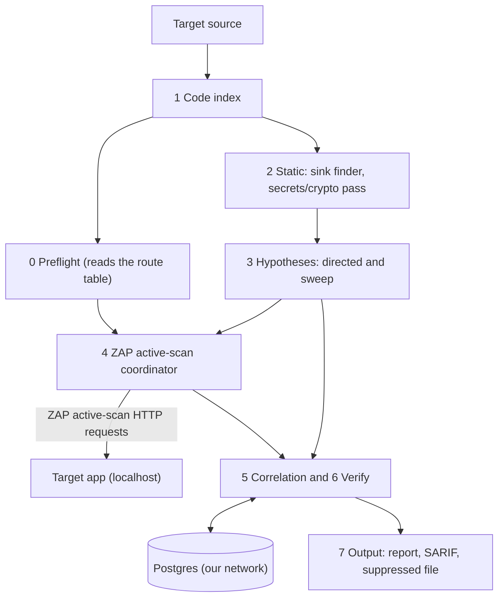

# SAST and DAST Correlation

CyberForge hackathon entry. Spec: [docs/prd.md](docs/prd.md). Current state: [docs/STATE.md](docs/STATE.md). Agent rules: [AGENTS.md](AGENTS.md).

Status: the pipeline is built through milestone M2 and the M3 Should list (`BS0`–`BS10`). It scans a Java/Spring source tree (local path or a Docker image) and probes the running app on localhost with OWASP ZAP, correlating the two. Live results and honest gaps: [docs/STATE.md](docs/STATE.md). See [docs/implementation-plan.md](docs/implementation-plan.md) for the build stages.

## 1. What it is

A Python CLI. It reads a Java web app's source code (SAST) and uses OWASP ZAP's active scanner to probe the running app on localhost (DAST). Static analysis produces hypotheses. Project orchestration scopes ZAP scans to those hypotheses and deterministic project oracles validate the captured responses. The result is one prioritised list in which each real bug appears once, with its code line and runtime evidence.

A firing probe proves that a route, param and CWE are exploitable. It does not prove which sink on that route is the cause. When several sinks could be the cause, the tool marks the link as ambiguous and keeps every candidate.

## 2. Approach

Details: [docs/architecture.md](docs/architecture.md).

| Area | Decision |
|---|---|
| Tool language | Python |
| Target app | Java / Spring Boot (primary). Practice target: OWASP VulnerableApp. Organisers' app framework: `[TODO: confirm at kickoff]`. JAX-RS adapter: Could. |
| Core idea | Static-guided dynamic testing. A directed hypothesis keeps its `hypothesis_id` into the evidence, so a direct hit is linked by lineage and not by matching afterwards. |
| Static analysis | Own code index (tree-sitter-java), own sink finder (per-CWE YAML catalogue, call name and receiver type, no dataflow) and own secrets/crypto pass. The call graph is walked backward from each sink to its routes. Static output gives route and call path, never the param. |
| Dynamic testing | ZAP active scanner is the required payload/probe engine. Project code schedules one scan per route and method, applies baseline gates, attributes each request by diffing it against its seed, replays candidate hits, applies differential oracles, and runs header/cookie checks. ZAP alerts alone do not decide verdicts. |
| Linking | `link_status` (unique or ambiguous) and `link_origin` (directed, sweep or back-guided). Confidence is a float from 0 to 1 with stored reasons. |
| Negative evidence | A finding with no oracle hit gets one status: `safe_pattern`, `no_http_path`, `blocked`, `tested_negative` or `untested`. `safe_pattern` and `tested_negative` findings are suppressed and written to a separate file. A coverage report lists what was not tested. Blocked or untested does not mean safe. |
| Labels | Confirmed, Code-only, Runtime-only (FR-7) |
| Optional adapters | Semgrep is optional and off by default. ZAP active scanning is required, including judging mode. |
| AI | Off by default and off in judging mode. It never creates or deletes a finding, sets a verdict or decides a link. |
| Persistence | Our own Postgres on its own Docker network and volume, separate from the target |
| Delivery | CLI only |

Run order: the route table is built first (static, no network). Preflight runs against it. Then static analysis, hypotheses, probing, correlation, verification and output.

Config names and defaults: the Config reference in [docs/architecture.md](docs/architecture.md#config-reference).

## 3. Vulnerability types covered

| Type | CWE | Found by | Tier |
|---|---|---|---|
| SQL injection | CWE-89 | Code and runtime | Must |
| Cross-site scripting | CWE-79 | Code and runtime | Must |
| Command injection | CWE-78 | Code and runtime | Must |
| Open redirect | CWE-601 | Code and runtime | Must |
| Path traversal | CWE-22 | Code and runtime | Should, M3, first after M2 |
| Hard-coded secrets | CWE-798 | Code only | Must (own secrets pass) |

Weak hashes, ciphers and random values are also reported as Code-only. VulnerableApp has no secrets module. Which of its modules stands in for the code-only path: `[TODO: crypto or JWT]`.

## 4. Finding record

Contract: [docs/finding-schema.md](docs/finding-schema.md). Code in `common/` is canonical. Every component reads and writes that record. SARIF is used only at the boundaries and is lossy. The VulnerableApp grader takes its own JSON.

## 5. Architecture



Our stack and the target app use separate Docker networks. ZAP reaches the target only over `localhost:<port>`, through its host-loopback API configuration. Active scans can change application state; use a disposable target instance and test data, never production. Localhost-only is a scope limit, not a sandbox.

## 6. Build stages and milestones

Work is built in stages, each with an exit test. Details: [docs/implementation-plan.md](docs/implementation-plan.md#build-stages).

| Build stages | Milestone | Scope |
|---|---|---|
| `BS0` to `BS5` | M1 spine | ZAP acceptance check, contract, code index, SQL sinks, probe spine. One command on a clean VulnerableApp run yields at least one Confirmed error-based SQL injection issue whose sink file and line match `expected_pairs`. |
| `BS6` to `BS9` | M2 core | All four classes, scheduler, `safe_pattern` and adequacy logic, suppressed file, coverage report, secrets pass, header and cookie checks, benchmark adapter, measurement, judging profile, generality checks |
| `BS10` | M3 extras | Path traversal, back-guided search, own flow engine, scan comparison, session manager, AI items |

None has passed. Status and evidence: [docs/STATE.md](docs/STATE.md).

## 7. Getting started

Prerequisites:

- Python 3.14 or later
- `uv`
- OWASP ZAP: the bare image pinned in [infra/zap.compose.yaml](infra/zap.compose.yaml), with its API bound to host loopback
- Docker and Docker Compose, for our Postgres and the target app

The target app runs separately, from its own Docker Compose, on localhost. Point the tool only at it. Scanning any other host is not allowed.

Install and test:

```sh
uv sync --locked --all-groups
uv run --locked pytest -q
uv run --locked ruff check .
```

`uv sync` installs the `elenchus` command into `.venv/bin` (`.venv\Scripts` on
Windows). Activate the environment to use it from the repository:

```sh
source .venv/bin/activate
elenchus --help
```

To run it from any working directory, add the absolute path to this project's
`.venv/bin` to your shell `PATH` (on Windows, add `.venv\Scripts`). Dependencies
live in `pyproject.toml` and are pinned in `uv.lock`. Add one with `uv add <package>`,
and commit both files. Semgrep is an optional adapter:
`uv sync --locked --all-groups --extra semgrep`.

One command runs the whole pipeline against the running target and its source:

1. Start the target app on loopback (for practice: `docker compose -f infra/vulnerableapp.compose.yaml up -d`).
2. Run the scan from the host. If no ZAP key is configured, the CLI creates a
   random key at `~/.elenchus/zap.key` with owner-only permissions. It starts
   the pinned ZAP Compose service when the local API is unavailable. It does
   not restart or reconfigure an already-running ZAP service. If that service
   rejects the saved key, stop it and rerun the scan, or configure
   `ZAP_API_KEY` with the key used by that service.

   Source from a **local path**:

   ```sh
   uv run --locked elenchus scan \
     --source-path <target-source-directory> \
     --base-url http://127.0.0.1:<target-port>/<context> \
     --no-store
   ```

   …or source from a **Docker image or container** (copied out and scanned):

   ```sh
   uv run --locked elenchus scan \
     --source-image <image-or-container> --source-image-path /abs/path/to/src \
     --base-url http://127.0.0.1:<target-port>/<context> \
     --no-store
   ```

   Practice target, end to end (ZAP + VulnerableApp running as above):

   ```sh
   uv run --locked elenchus scan \
     --source-path .targets/VulnerableApp \
     --base-url http://127.0.0.1:9090/VulnerableApp --no-store
   ```

   In an interactive terminal, the CLI offers the raw report, a deterministic
   grouped summary, or SARIF JSON on stdout. Enter selects the raw report.
   The summary uses current issue fields and any existing AI advisory notes; it
   does not make an AI request, and advisory remediation text is marked
   unverified. When output is piped, the raw report is the default.
   Runtime findings show the HTTP endpoint and the identified query, path, or
   body parameter when the request evidence records its location. Where static
   indexing provides a route-to-sink call path, the report labels it as an
   indexed candidate path, not a runtime trace or proof of the exact sink.

   Select text output explicitly with `--output-mode raw|summary|both`.
   `--output-format json` skips the prompt. `--sarif-output <file>` writes
   SARIF alongside the selected report and skips the prompt;
   `--sarif-output -` writes SARIF to stdout instead. Rich progress is shown
   only in a terminal, can be disabled with `--no-progress`, and honors
   `NO_COLOR`.

   Other options: `--judging` (competition profile, <5 min, AI/Semgrep off),
   `--config <file.toml>` (tune budgets and other [Config reference](docs/architecture.md#config-reference)
   keys), `--ci` (exit 1 on a Confirmed high/critical issue). Omit `--no-store`
   to persist; start Postgres and set `DATABASE_URL` (see
   [infra/README.md](infra/README.md)).

   For a longer VulnerableApp benchmarking run, use the repository-root
   `benchmark.toml` and omit `--judging`:

   ```sh
   uv run --locked elenchus scan \
     --source-path .targets/VulnerableApp \
     --base-url http://127.0.0.1:9090/VulnerableApp \
     --expected-pairs common/fixtures/expected_pairs/vulnerableapp.yaml \
     --config benchmark.toml \
     --no-store
   ```

   This config allows up to two hours for ZAP jobs and 30 minutes for replay
   verification. Those are deadlines, not guarantees that every planned job
   succeeds; check the coverage report for skipped, errored, or untested work.

   To measure full benchmark recall, first capture the target's official ground
   truth. Supply the source CSV, Java vulnerability-type metadata, and exact
   loopback DAST endpoint; the snapshot command does not infer or invent
   vulnerable parameters:

   ```sh
   uv run --locked python -m producers.benchmark snapshot \
     --source-root .targets/VulnerableApp \
     --base-url http://127.0.0.1:9090/VulnerableApp \
     --sast-ground-truth src/main/resources/scanner/sast/expectedIssues.csv \
     --type-metadata src/main/java/org/sasanlabs/vulnerability/types/VulnerabilityType.java \
     --dast-endpoint http://127.0.0.1:9090/VulnerableApp/scanner/dast \
     --sast-output common/fixtures/benchmarks/vulnerableapp-sast.json \
     --dast-output common/fixtures/benchmarks/vulnerableapp-dast.json
   ```

   Score source findings against the full SAST snapshot:

   ```sh
   uv run --locked python -m producers.benchmark sast .targets/VulnerableApp \
     --expected common/fixtures/benchmarks/vulnerableapp-sast.json
   ```

   Save a scan's JSON output and score its runtime findings against the full
   DAST snapshot:

   ```sh
   uv run --locked elenchus scan \
     --source-path .targets/VulnerableApp \
     --base-url http://127.0.0.1:9090/VulnerableApp \
     --config benchmark.toml --output-format json --no-store \
     > /tmp/elenchus-vulnerableapp-scan.json
   uv run --locked python -m producers.benchmark dast \
     /tmp/elenchus-vulnerableapp-scan.json \
     --expected common/fixtures/benchmarks/vulnerableapp-dast.json
   ```

   These snapshots are measurement-only. DAST cases contain route, method,
   vulnerability type and target metadata, but no parameter ground truth; they
   never feed scan planning or correlation. The report shows raw and supported
   scores side by side and lists misses. A route/CWE match may count for more
   than one expected type on that route, matching the target comparator's
   route/method/CWE semantics.

3. Compare two stored runs (B-5): `uv run --locked elenchus compare --base <run_id> --current <run_id>`.

Coverage: SQL injection (CWE-89, error/union/blind), OS command injection (CWE-78), reflected XSS (CWE-79) and open redirect (CWE-601) are probed dynamically with deterministic oracles; a static secrets/weak-crypto pass adds CWE-798/327/330 as Code-only. Path traversal (CWE-22) has an oracle but is not confirmable on VulnerableApp (its reader is classpath-based; see [docs/STATE.md](docs/STATE.md)). Details: [docs/implementation-plan.md](docs/implementation-plan.md).

## 8. Continuous integration

GitHub Actions runs the tests, checks the CLI entry point, builds the Python distributions and builds the CLI container image on pushes to `main` and on pull requests. Workflow: [`.github/workflows/ci.yml`](.github/workflows/ci.yml).

## 9. Third-party tools used

The challenge rules require this list. The sink finder, secrets pass, ZAP scan coordinator, deterministic oracles, linking, correlation and scoring are our own work; ZAP generates and sends active-scan requests.

| Tool | Role |
|---|---|
| tree-sitter, tree-sitter-java | Parser for the code index |
| psycopg | Postgres client |
| PostgreSQL (`postgres:17-alpine` image) | Run store |
| pytest, Ruff | Tests and lint (dev) |
| Semgrep | Optional adapter and offline benchmark yardstick. An optional extra in `pyproject.toml`. |
| OWASP ZAP | Required active-scan engine. Its API is driven by the project coordinator; project-owned oracles validate findings. |

Versions: Python dependencies are constrained in `pyproject.toml` and pinned in `uv.lock`. Record the ZAP image/version and Semgrep yardstick rule-pack version in [docs/STATE.md](docs/STATE.md) when measured.

## 10. Metric targets

From the PRD. Good qualifies. Great stands out. These are targets, not results. Current measured results and their evidence are in [docs/STATE.md](docs/STATE.md). When measured, the supported-CWE score is shown beside the raw score.

| What we measure | Good | Great |
|---|---|---|
| Code detection | Over 60% | Over 85% |
| Runtime detection | Over 50% | Over 80% |
| Correct links (of 20 pairs) | Over 50% | Over 80% |
| Wrong links | Under 20% | Under 5% |
| False alarms (safe decoys) | Under 30% | Under 10% |
| Unseen app (pairs linked) | Over 40% | Over 65% |
| Run time | Under 15 minutes | Under 5 minutes |

Test app facts: 36 planted vulnerabilities (20 pairs, 10 code-only, 6 runtime-only), about 8 safe decoys, and an unseen second app at judging.

## 11. Scope, team and licence

Non-goals, per the PRD:

- No UI, API or server. CLI report only.
- No automatic code fixes.
- No login, users or cloud deployment.
- One target framework per run.

Team: `[TODO: names]`

Licence: `[TODO]`

Docs:

| Doc | Content |
|---|---|
| [docs/architecture.md](docs/architecture.md) | Pipeline, judging mode, config reference, residual flaws |
| [docs/finding-schema.md](docs/finding-schema.md) | Record contract, statuses, examples |
| [docs/implementation-plan.md](docs/implementation-plan.md) | Build stages, milestones, fixtures, decoy plan |
| [docs/repo-structure.md](docs/repo-structure.md) | What lives where, module boundary |
| [docs/STATE.md](docs/STATE.md) | Current state and open questions |
