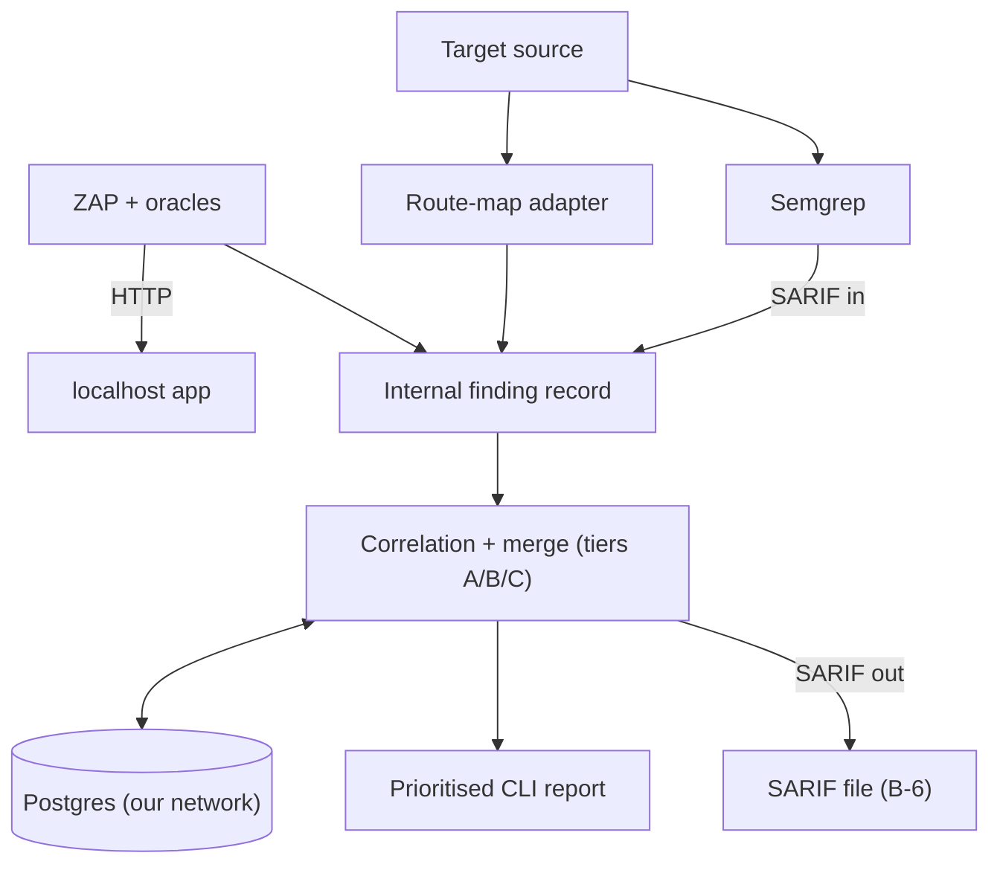

Design stage. See docs/architecture.md for the current design.

# SAST and DAST Correlation

CyberForge hackathon entry. Spec: [docs/prd.md](docs/prd.md). Agent rules: [AGENTS.md](AGENTS.md). Build order: [docs/implementation-plan.md](docs/implementation-plan.md). Who owns what: [docs/repo-structure.md](docs/repo-structure.md), [CONTRIBUTING.md](CONTRIBUTING.md).

Status: the Spring route-map parser, Semgrep SAST producer, localhost-scoped ZAP producer, consumer engine, and CLI scan orchestration are implemented. Producer tests pass; a real ZAP/VulnerableApp DAST run and fresh benchmark metrics have not been verified.

## 1. What it is

A Python CLI. It scans a web app's source code (SAST) and its running instance on localhost (DAST). It correlates the two sets of findings into one prioritised list. Each real bug appears once, with its code line and its runtime proof.

## 2. Approach

Details: [docs/architecture.md](docs/architecture.md), [docs/decisions.md](docs/decisions.md).

| Area | Decision |
|---|---|
| Tool language | Python |
| Target app | Java / Spring Boot (primary). Practice target: OWASP VulnerableApp. Organisers' app framework: `[TODO: confirm at kickoff]` |
| Framework adapters | SAST rules and route-map parser per framework. Spring MVC first, JAX-RS second. Core is framework-agnostic. |
| SAST | Semgrep taint and pattern rules for injection and selected secrets/crypto cases. SARIF is ingested into internal findings. |
| Secrets/crypto pass | Semgrep pattern rules for hard-coded credentials, weak hashes/ciphers, weak random, and password-hash work factor. |
| DAST | ZAP API, scoped to localhost and seeded from the route map. Deterministic response oracles filter alerts. |
| Route map | Source → URL template → file, handler, line range, params, and bounded call edges. Parsed with tree-sitter-java. |
| Correlation | Our own logic. Confidence tiers A / B / C. Tier B is the main path on Spring. |
| Runtime verdicts | Deterministic oracles only. The AI never decides an exploit worked. |
| Labels | Confirmed / Code-only / Runtime-only (FR-7) |
| Result format | Internal finding record inside the engine. SARIF 2.1.0 at the edges only: Semgrep SARIF in, correlated SARIF out (B-6). |
| Persistence | Our own Postgres on its own Docker network and volume, separate from the target. Runs, findings, issues, evidence, benchmark results. |
| Delivery | CLI only |

### Correlation tiers

CWE must match in every tier. Param match guards against wrong links.

| Tier | Rule |
|---|---|
| A | SAST sink line inside the DAST route's handler span, same param |
| B | DAST route is in the SAST record's `reached_via`: a handler calls the method holding the sink (Spring controller → service) |
| C | Route + param only. Low confidence. |

- Linked pair → **Confirmed**
- SAST finding with no link → **Code-only**
- DAST finding with no code location → **Runtime-only** (e.g. missing security headers)

Dedupe key: `(cwe, file, line)` when present, else `(cwe, route, method, param)`. A newly linked pair merges into any stored issue matching either key.

Tier B uses one-hop call edges from the route-map parser, not a cross-file taint trace. Semgrep OSS taint stays inside one function.

### Oracles

Every runtime verdict comes from a deterministic check. The AI never decides that an exploit worked.

| Type | Oracle |
|---|---|
| SQL injection | Database error signature in response; time-only alerts are not confirmed. |
| XSS | ZAP attack string reflected unescaped in response. |
| Command injection | Recognized command-output marker reflected; time-only alerts are not confirmed. |
| Open redirect | Redirect response has an absolute external `Location`; it is not followed. |
| Missing security header | Named header absent from response headers. |

Alerts without matching deterministic evidence are discarded. Exact API setup and remaining limitations are in [docs/architecture.md](docs/architecture.md).

## 3. Vulnerability types covered

| Type | CWE | Found by | Status |
|---|---|---|---|
| SQL injection | CWE-89 | Code and runtime | Committed |
| Cross-site scripting | CWE-79 | Code and runtime | Committed |
| Command injection | CWE-78 | Code and runtime | Committed |
| Open redirect | CWE-601 | Code and runtime | Committed |
| Path traversal | CWE-22 | Code and runtime | Stretch |

Hard-coded secrets (CWE-798) are code-only. The secrets/crypto pass reports them as Code-only. VulnerableApp has no secrets module, so its crypto or JWT module stands in during practice.

## 4. Finding schema

Draft contract: [docs/finding-schema.md](docs/finding-schema.md). The internal finding record is frozen first. Every component reads and writes it. SARIF is used only for ingest and export, and the export is lossy. `type` and `cwe` align to the VulnerableApp grader vocabulary.

## 5. Architecture



Our stack and the target app use separate Docker networks. Our scanner reaches the target only over `localhost:<port>`. Details: [docs/architecture.md](docs/architecture.md).

## 6. Getting started

Prerequisites:

- Python 3.14+
- `uv` for the locked environment (Semgrep is installed as a project dependency)
- OWASP ZAP with its API bound to `127.0.0.1:8090`
- Docker and Docker Compose for Postgres and the target app

The target app runs separately, from its own Docker Compose, on localhost. The DAST scanner refuses non-local target URLs. Do not point it at any other host.

Steps:

1. Install the locked dependencies with `uv sync --locked`.
2. Start the target app using its own Compose instructions and note its localhost URL.
3. Start OWASP ZAP with its API bound to loopback and set `ZAP_API_KEY`. For Docker on Linux, host networking keeps both the API and localhost-only target reachable on host loopback:

   ```sh
   export ZAP_API_KEY="$(python -c 'import secrets; print(secrets.token_urlsafe(32))')"
   docker run --rm --network host --name elenchus-zap \
     -e ZAP_API_KEY="$ZAP_API_KEY" zaproxy/zap-stable \
     zap.sh -daemon -host 127.0.0.1 -port 8090 \
     -config api.key="$ZAP_API_KEY"
   ```

4. Run the producers from the host, not from the CLI container:

   ```sh
   uv run elenchus scan \
     --source-path <target-source-directory> \
     --base-url http://127.0.0.1:<target-port>/<context> \
     --no-store
   ```

   Omit `--no-store` to persist results; start our PostgreSQL service and configure `DATABASE_URL` first.
5. Read the prioritized report. Add `--sarif-output report.sarif` to write SARIF.

## 7. Continuous integration

GitHub Actions runs the test suite, checks the CLI entry point, builds the Python distributions, and builds the CLI container image on pushes to `main` and pull requests targeting `main`. The workflow can also be started manually from the Actions tab. It does not publish an image or deploy the CLI.

Workflow: [`.github/workflows/ci.yml`](.github/workflows/ci.yml).

## 8. Open-source scanners used

The challenge rules require this list. The correlation logic (route map join, tiers, merging, labelling, prioritisation) is our own work.

| Tool | Role | Rulesets / config |
|---|---|---|
| Semgrep | SAST, taint mode | OWASP Java ruleset `[TODO: exact rulesets]` |
| gitleaks or Semgrep secret rules | Secrets/crypto pass | `[TODO: confirm]` |
| OWASP ZAP | DAST | `[TODO: scan policy]` |
| Nuclei | Optional, bonus only | `[TODO]` |

Versions: `[TODO]`

## 9. Metric targets

From the PRD. Good qualifies; Great stands out. No results measured yet.

| What we measure | Good | Great |
|---|---|---|
| Code detection | Over 60% | Over 85% |
| Runtime detection | Over 50% | Over 80% |
| Correct links (of 20 pairs) | Over 50% | Over 80% |
| Wrong links | Under 20% | Under 5% |
| False alarms (safe decoys) | Under 30% | Under 10% |
| Unseen app (pairs linked) | Over 40% | Over 65% |
| Run time | Under 15 minutes | Under 5 minutes |

Test app facts: 36 planted vulnerabilities (20 pairs, 10 code-only, 6 runtime-only), about 8 safe decoys, and an unseen second app at judging.
