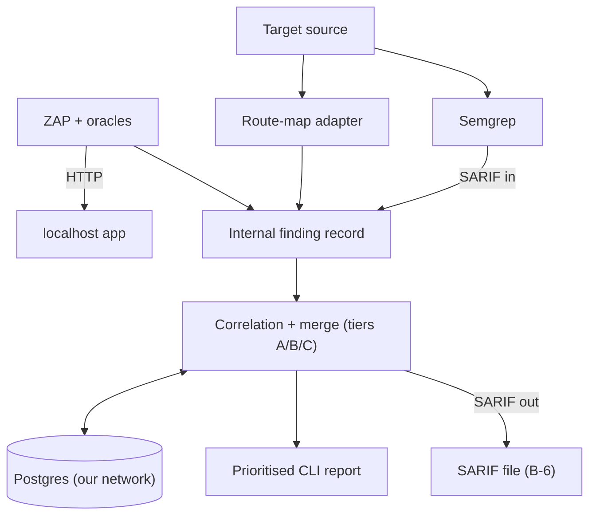

# SAST and DAST Correlation

CyberForge hackathon entry. Spec: [docs/prd.md](docs/prd.md). Agent rules: [AGENTS.md](AGENTS.md). Build order: [docs/implementation-plan.md](docs/implementation-plan.md). Who owns what: [docs/repo-structure.md](docs/repo-structure.md), [CONTRIBUTING.md](CONTRIBUTING.md).

Status: the Spring route-map parser and initial Person B consumer path are implemented. End-to-end scanning and benchmark metrics are not yet available.

## 1. What it is

A Python CLI. It scans a web app's source code (SAST) and its running instance on localhost (DAST). It correlates the two sets of findings into one prioritised list. Each real bug appears once, with its code line and its runtime proof.

## 2. Approach

Details: [docs/architecture.md](docs/architecture.md), [docs/decisions.md](docs/decisions.md).

| Area | Decision |
|---|---|
| Tool language | Python |
| Target app | Java / Spring Boot (primary). Practice target: OWASP VulnerableApp. Organisers' app framework: `[TODO: confirm at kickoff]` |
| Framework adapters | SAST rules and route-map parser per framework. Spring MVC first, JAX-RS second. Core is framework-agnostic. |
| SAST | Semgrep taint mode for the four injection classes. Sanitiser-aware, so parameterised-query decoys are not reported. |
| Secrets/crypto pass | gitleaks or Semgrep secret rules `[TODO: confirm]` |
| DAST | OWASP ZAP, seeded from the route map. Active scan for injection, passive scan for headers. |
| Route map | Source → URL template → file, handler, line range, params. Parsed with tree-sitter-java or javalang `[TODO: confirm]` |
| Correlation | Our own logic. Confidence tiers A / B / C. Tier B is the main path on Spring. |
| Runtime verdicts | Deterministic oracles only. The AI never decides an exploit worked. |
| Labels | Confirmed / Code-only / Runtime-only (FR-7) |
| Result format | Internal finding record inside the engine. SARIF 2.1.0 at the edges only: Semgrep SARIF in, correlated SARIF out (B-6). |
| Persistence | Our own Postgres on its own Docker network and volume, separate from the target. Runs, findings, issues, evidence, benchmark results. |
| Delivery | CLI only |

### Correlation tiers

CWE must match in every tier. Param match guards against wrong links.

| Tier | Rule |
|---|---|
| A | SAST sink line inside the DAST route's handler span, same param |
| B | DAST route is in the SAST record's `reached_via`: a handler calls the method holding the sink (Spring controller → service) |
| C | Route + param only. Low confidence. |

- Linked pair → **Confirmed**
- SAST finding with no link → **Code-only**
- DAST finding with no code location → **Runtime-only** (e.g. missing security headers)

Dedupe key: `(cwe, file, line)` when present, else `(cwe, route, method, param)`. A newly linked pair merges into any stored issue matching either key.

Tier B uses one-hop call edges from the route-map parser, not a cross-file taint trace. Semgrep OSS taint stays inside one function.

### Oracles

Every runtime verdict comes from a deterministic check. The AI never decides that an exploit worked.

| Type | Oracle |
|---|---|
| SQL injection | DB error string, or time delay |
| XSS | Reflected unescaped marker |
| Command injection | Response time delay |
| Open redirect | `Location` header host |

Delay thresholds and marker formats: `[TODO]`

## 3. Vulnerability types covered

| Type | CWE | Found by | Status |
|---|---|---|---|
| SQL injection | CWE-89 | Code and runtime | Committed |
| Cross-site scripting | CWE-79 | Code and runtime | Committed |
| Command injection | CWE-78 | Code and runtime | Committed |
| Open redirect | CWE-601 | Code and runtime | Committed |
| Path traversal | CWE-22 | Code and runtime | Stretch |

Hard-coded secrets (CWE-798) are code-only. The secrets/crypto pass reports them as Code-only. VulnerableApp has no secrets module, so its crypto or JWT module stands in during practice.

## 4. Finding schema

Draft contract: [docs/finding-schema.md](docs/finding-schema.md). The internal finding record is frozen first. Every component reads and writes it. SARIF is used only for ingest and export, and the export is lossy. `type` and `cwe` align to the VulnerableApp grader vocabulary.

## 5. Architecture

Our stack and the target app use separate Docker networks. Our scanner reaches the target only over `localhost:<port>`. Details: [docs/architecture.md](docs/architecture.md).

## 6. Getting started

Prerequisites:

- Python `[TODO: version]`
- Semgrep `[TODO]`
- OWASP ZAP `[TODO: install method]`
- Docker and Docker Compose, to run our Postgres and the target app

The target app runs separately, from its own Docker Compose, on localhost. Our DAST scanner points only at that app. Do not point it at any other host.

Steps:

1. Start our stack (Postgres on its own network and volume): `[TODO]`
2. Start the target app: `[TODO: per organisers' instructions, or VulnerableApp's Compose file]`
3. Install the tool: `[TODO]`
4. Run a scan with the source path and localhost URL: `[TODO: CLI command]`
5. Read the prioritised report: `[TODO]`

## 7. Continuous integration

GitHub Actions runs the test suite, checks the CLI entry point, builds the Python distributions, and builds the CLI container image on pushes to `main` and pull requests targeting `main`. The workflow can also be started manually from the Actions tab. It does not publish an image or deploy the CLI.

Workflow: [`.github/workflows/ci.yml`](.github/workflows/ci.yml).

## 8. Open-source scanners used

The challenge rules require this list. The correlation logic (route map join, tiers, merging, labelling, prioritisation) is our own work.

| Tool | Role | Rulesets / config |
|---|---|---|
| Semgrep | SAST, taint mode | OWASP Java ruleset `[TODO: exact rulesets]` |
| gitleaks or Semgrep secret rules | Secrets/crypto pass | `[TODO: confirm]` |
| OWASP ZAP | DAST | `[TODO: scan policy]` |
| Nuclei | Optional, bonus only | `[TODO]` |

Versions: `[TODO]`

## 9. Metric targets

From the PRD. Good qualifies; Great stands out. No results measured yet.

| What we measure | Good | Great |
|---|---|---|
| Code detection | Over 60% | Over 85% |
| Runtime detection | Over 50% | Over 80% |
| Correct links (of 20 pairs) | Over 50% | Over 80% |
| Wrong links | Under 20% | Under 5% |
| False alarms (safe decoys) | Under 30% | Under 10% |
| Unseen app (pairs linked) | Over 40% | Over 65% |
| Run time | Under 15 minutes | Under 5 minutes |

Test app facts: 36 planted vulnerabilities (20 pairs, 10 code-only, 6 runtime-only), about 8 safe decoys, and an unseen second app at judging.
