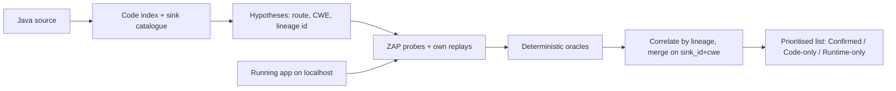
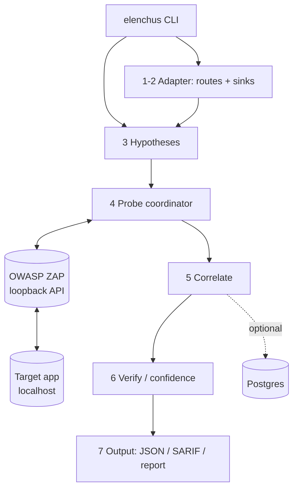

<div align="center">

# ἔλεγχος · elenchus

### SAST + DAST correlation for Java/Spring — one list, each real bug once, with the line that causes it and the proof it is exploitable

<p>
  <a href="https://github.com/ROHITH-KUMAR-L/elenchus/actions/workflows/ci.yml"></a>
  
  
  
  
  
</p>

<p>
  
  
  
  
  
</p>

<sub><b>CyberForge hackathon entry</b> · <a href="docs/prd.md">Spec</a> · <a href="docs/architecture.md">Architecture</a> · <a href="docs/STATE.md">State</a> · <a href="docs/finding-schema.md">Finding schema</a></sub>

</div>

---

A Python CLI that scans a Java/Spring application's **source code** (SAST) and its
**running instance** (DAST), then **correlates** the two so each real vulnerability
appears once — with the code line that causes it and the runtime proof that it is
exploitable.

#### Contents

[Problem](#problem) · [How we solve it](#how-we-solve-it) · [Run](#run) · [Advisory AI](#advisory-ai-catalogue-gap-proposer-optional-off-by-default) · [Results](#results) · [Engineering practices](#engineering-practices)

## Problem

Security teams run two kinds of scanners that never meet:

- **SAST** reads source code → "SQL injection at `orders.java:88`" but can't prove it is reachable.
- **DAST** attacks the running app → "SQL injection at `/api/orders?id=`" but can't say which code to fix.

The result is duplicate tickets, noisy false alarms, and no clear priority. The
challenge is to **link the runtime finding to the code that causes it**, merge
duplicates, and produce one prioritised list.

## How we solve it

**Static-guided dynamic testing with deterministic oracles.**

1. **Static analysis makes hypotheses.** An own tree-sitter code index + per-CWE
   YAML sink catalogue (anchored on low-level JDK/Spring APIs, never app names)
   finds sinks and walks the call graph back to the routes that reach them.
2. **ZAP probes, the project orchestrates.** OWASP ZAP's active scanner is the
   payload engine. Each probe carries a `hypothesis_id`, so a hit is **linked by
   lineage**, not matched afterward.
3. **Project oracles own the verdict.** Deterministic differential oracles
   (SQL error, command output, reflected XSS, open redirect, boolean-blind SQL)
   decide every verdict on a replayed response — a ZAP alert alone never does.
4. **Correlation + prioritisation.** Findings merge on `(sink_id, cwe)`; each
   issue is labelled Confirmed / Code-only / Runtime-only, scored, and ranked.

Safety: DAST targets `localhost` only, scoped to the route table; AI and Semgrep
are off by default and in judging mode; the whole run stays under 5 minutes.

### Methodology



### System architecture



## Run

```bash
# infra: ZAP (loopback API) + the target app, via Docker Compose
docker compose -f infra/zap.compose.yaml up -d
docker compose -f infra/vulnerableapp.compose.yaml up -d

# one command; judging profile = ZAP on, AI/Semgrep off, <5 min
export ZAP_API_KEY=...            # from the ZAP service
uv run elenchus scan --judging \
  --source-path .targets/VulnerableApp \
  --base-url http://127.0.0.1:9090/VulnerableApp
```

Open-source components (correlation logic is our own): **OWASP ZAP** (active
scanning), **tree-sitter-java** (parsing), optional **Semgrep** (offline
cross-check only).

### Advisory AI: catalogue-gap proposer (optional, off by default)

Recall and precision are bound by the sink catalogue, which names only low-level
APIs and cannot name an app's own wrapper utilities. With AI on, an advisory task
proposes candidate catalogue entries for those wrappers — app methods that forward
a value to a known sink (`sink`), and app methods that neutralise a class
(`sanitiser`).

It never changes the live catalogue and never creates a finding, verdict or link.
Its only output is `out/<run>/catalogue_proposals.json`, grouped into `accepted`,
`needs_human_review` and `rejected`, for a human or CI to review.

| Guardrail | Rule |
|---|---|
| Symbols | Every proposed `receiver_type`/`method` must resolve in the parsed source, or it is rejected. |
| Acceptance | `accepted` only when a decoy twin shows adding it flags the vulnerable twin and no safe twin. |
| No twin | On a normal scan no twin is available, so every surviving proposal is `needs_human_review` and nothing is applied. |
| Scope | Off in judging mode. Validated against a JSON schema, cached, capped by `ai.max_calls`. |

Enable with a config file and the `GROQ_*` environment (any missing ⇒ AI off):

```toml
[ai]
enabled = true
[ai.tasks.catalogue_proposer]
enabled = true
```

```bash
uv run elenchus scan --config ai.toml \
  --source-path .targets/VulnerableApp \
  --base-url http://127.0.0.1:9090/VulnerableApp
```

An accepted entry derived from a test app is recorded as fitted in
[docs/STATE.md](docs/STATE.md) and `catalogue/freeze.json` when a reviewer applies
it.

At the end of an interactive scan the results are stored and the report menu
loops over five options until you exit — **1** raw report, **2** findings
overview, **3** SARIF, **4** AI summary (a prose executive summary via
`ai.tasks.report_summary`), **5** exit. The scan runs once; only the menu loops,
so you can view the same run several ways. Before the menu, the AI endpoint is
checked once so you know whether option 4 is live. The AI summary describes the
deterministic verdicts and never changes them; with AI off it falls back to the
overview and says so.

## Results

Measured locally on **OWASP VulnerableApp** (full scan, live OWASP ZAP). SAST
scores are against VulnerableApp's own `expectedIssues` export (a superset
spanning 30 CWE types); the organisers' answer key will differ. "Supported" =
the CWE classes the tool targets.

One scan: **61 findings across 11 CWE classes — 12 Confirmed, 36 Code-only,
13 Runtime-only, 0 wrong links.**

| PRD metric | Good / Great | Result |
|---|---|---|
| Code detection (SAST, supported CWEs) | >60% / >85% | **23/35 (66%)** — SQL 9/9, XSS 11/19, cmd 2/2 |
| Runtime detection (DAST) | >50% / >80% | SQL-89, XSS-79, cmd-78, open-redirect-601 all confirmed live |
| Correct links (planted pairs) | >50% / >80% | **12/20 (60%)** Confirmed: SQL-89 ×9, XSS-79 ×2, cmd-78 ×1 |
| Wrong links | <20% / <5% | **0** |
| Run time | <15m / <5m | `--judging` **< 5 min**; full report run ~12.7 min |
| Second framework (B-7) | bonus | servlet adapter runs on OWASP BenchmarkJava (SAST): 5480 routes, 1806 sinks |

Probe health on that run: attribution 0.952, header propagation 1.000, no state
drift, no foreign hosts.

Honest gaps (details in [docs/STATE.md](docs/STATE.md)): static XSS catches the
unescaped sinks but not escaped-yet-bypassable ones; XSS on handlers that bind
every parameter (`Map<String,String>`) stays Code-only; open redirect is
confirmed dynamically but has no safe general static anchor on this app;
without the flow engine, precision on a hold-out like BenchmarkJava is
discrimination-limited (high recall, high false-positive rate).

## Engineering practices

| Area | Practice |
|---|---|
| **Reproducible builds** | [`uv`](https://docs.astral.sh/uv/) with a committed `uv.lock`; every command runs `--locked`, so the dependency graph is pinned and identical on CI and locally. |
| **Containerisation** | Multi-stage [`cli/Dockerfile`](cli/Dockerfile); the image runs as a non-root user (`uid 10001`) and ships without Semgrep. Our Postgres runs on its own Docker network and volume, never wired to the target. |
| **CI/CD** | [GitHub Actions](.github/workflows/ci.yml) runs tests, the CLI entry point, the distribution build and the container build on every push and PR. |
| **Test discipline** | 423 tests. Decoy *twins* (a vulnerable and a safe variant per rule) catch over-clearing; a generality CI test bans test-app names from tool code; the pipeline passes with AI and Semgrep absent. |
| **Linting & style** | [Ruff](https://docs.astral.sh/ruff/) gates CI; the codebase is import-sorted and warning-clean. |
| **Contract-first** | One canonical finding record in `common/`; a schema doc-sync test fails if config defaults drift from the docs. SARIF is boundary-only and never passed internally. |
| **Safety by construction** | DAST is loopback-only and scoped to the route table; ZAP's API binds to 127.0.0.1; replays never follow redirects; a run-end check fails loudly on any non-loopback host. |
| **Deterministic core, advisory AI** | Oracles decide every verdict. AI is off by default and in judging mode, schema-validated, content-hash cached and call-budgeted; it never creates a finding, verdict or link. |
| **Secrets hygiene** | No credentials in the repo; the ZAP key auto-generates to `~/.elenchus/`; `.env.example` documents configuration without values. |
| **Honest measurement** | Supported-CWE score shown beside the raw score; every miss listed and tagged; nothing is reported as working until it has run live. |

### Verify the AI credentials

The AI features are optional and read `GROQ_BASE_URL`, `GROQ_API_KEY` and
`GROQ_MODEL` from the environment (or the generic `LLM_*` fallback). Verify them
without running a scan:

```bash
GROQ_BASE_URL=https://api.groq.com/openai/v1 GROQ_API_KEY=gsk_... GROQ_MODEL=llama-3.3-70b-versatile \
  uv run --locked python scripts/ai_check.py
```

It reports whether the client is configured and, when it is, makes one minimal
live call and prints success and latency. With any variable unset it reports
`not configured` and AI simply stays off.

**Transport.** By default the client calls the endpoint with the standard library
and retries transient WAF/rate-limit errors. For the most reliable path — some
providers (Groq) front their API with Cloudflare, which can block the plain
client — install the optional OpenAI SDK, which the client then uses automatically
(HTTP/2, a browser-like signature):

```bash
uv sync --locked --all-groups --extra ai      # once
uv run --locked --extra ai elenchus scan ...   # or add --extra ai to any run
```
