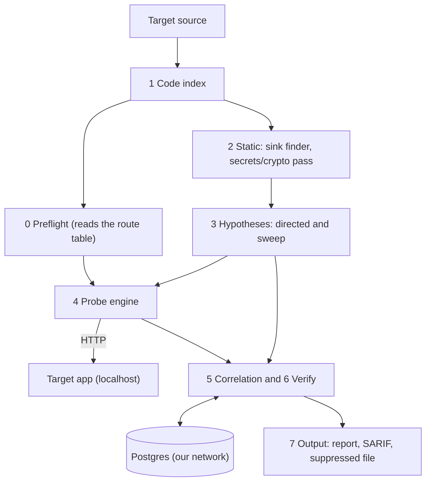

# SAST and DAST Correlation

CyberForge hackathon entry. Spec: [docs/prd.md](docs/prd.md). Current state: [docs/STATE.md](docs/STATE.md). Agent rules: [AGENTS.md](AGENTS.md).

Status: design stage. The pipeline described below is a plan. Nothing in it is built, tested or measured. The code in the tree is an older pipeline (route-map parser, Semgrep and ZAP producers, a tier-based engine, a CLI). It is being reworked. See [docs/implementation-plan.md](docs/implementation-plan.md).

## 1. What it is

A Python CLI. It reads a Java web app's source code (SAST) and probes the running app on localhost (DAST). Static analysis produces hypotheses. The probe engine tests them. The result is one prioritised list in which each real bug appears once, with its code line and its runtime proof.

A firing probe proves that a route, param and CWE are exploitable. It does not prove which sink on that route is the cause. When several sinks could be the cause, the tool marks the link as ambiguous and keeps every candidate.

## 2. Approach

Details: [docs/architecture.md](docs/architecture.md).

| Area | Decision |
|---|---|
| Tool language | Python |
| Target app | Java / Spring Boot (primary). Practice target: OWASP VulnerableApp. Organisers' app framework: `[TODO: confirm at kickoff]`. JAX-RS adapter: Could. |
| Core idea | Static-guided dynamic testing. A directed hypothesis keeps its `hypothesis_id` into the evidence, so a direct hit is linked by lineage and not by matching afterwards. |
| Static analysis | Own code index (tree-sitter-java), own sink finder (per-CWE YAML catalogue, call name and receiver type, no dataflow) and own secrets/crypto pass. The call graph is walked backward from each sink to its routes. Static output gives route and call path, never the param. |
| Dynamic testing | Own probe engine. Baseline gate, differential oracles, canary id, replay log, own header and cookie checks. Oracles decide every verdict. |
| Linking | `link_status` (unique or ambiguous) and `link_origin` (directed, sweep or back-guided). Confidence is a float from 0 to 1 with stored reasons. |
| Negative evidence | A finding with no oracle hit gets one status: `no_http_path`, `blocked`, `tested_negative` or `untested`. `tested_negative` findings are suppressed and written to a separate file. |
| Labels | Confirmed, Code-only, Runtime-only (FR-7) |
| Optional adapters | Semgrep and ZAP. Off by default. No pipeline stage requires them. |
| AI | Off by default and off in judging mode. It never creates or deletes a finding, sets a verdict or decides a link. |
| Persistence | Our own Postgres on its own Docker network and volume, separate from the target |
| Delivery | CLI only |

Run order: the route table is built first (static, no network). Preflight runs against it. Then static analysis, hypotheses, probing, correlation, verification and output.

Config names and defaults: the Config reference in [docs/architecture.md](docs/architecture.md#config-reference).

## 3. Vulnerability types covered

| Type | CWE | Found by | Tier |
|---|---|---|---|
| SQL injection | CWE-89 | Code and runtime | Must |
| Cross-site scripting | CWE-79 | Code and runtime | Must |
| Command injection | CWE-78 | Code and runtime | Must |
| Open redirect | CWE-601 | Code and runtime | Must |
| Path traversal | CWE-22 | Code and runtime | Should, M3, first after M2 |
| Hard-coded secrets | CWE-798 | Code only | Must (own secrets pass) |

Weak hashes, ciphers and random values are also reported as Code-only. VulnerableApp has no secrets module. Which of its modules stands in for the code-only path: `[TODO: crypto or JWT]`.

## 4. Finding record

Contract: [docs/finding-schema.md](docs/finding-schema.md). Code in `common/` is canonical. Every component reads and writes that record. SARIF is used only at the boundaries and is lossy. The VulnerableApp grader takes its own JSON.

## 5. Architecture



Our stack and the target app use separate Docker networks. The probe engine reaches the target only over `localhost:<port>`.

## 6. Milestones

| Milestone | Scope |
|---|---|
| M1 spine | One command on a clean VulnerableApp run yields at least one Confirmed error-based SQL injection issue whose sink file and line match `expected_pairs` |
| M2 core | All four classes, secrets pass, header and cookie checks, the `tested_negative` logic and suppressed file, judging profile, benchmark adapter |
| M3 extras | Path traversal, back-guided search, own flow engine, scan comparison, session manager, AI items |

None has passed. Status and evidence: [docs/STATE.md](docs/STATE.md).

## 7. Getting started

Prerequisites:

- Python 3.14 or later
- `uv`
- Docker and Docker Compose, for our Postgres and the target app

The target app runs separately, from its own Docker Compose, on localhost. Point the tool only at it. Scanning any other host is not allowed.

Redesigned pipeline: the run command `[TODO]`. The target base URL will be a required input (`--target`). Everything else is detected.

Install and test (these run the older components):

```sh
uv sync --locked
uv run python -m pytest -q
```

Older pipeline commands (the code that exists today). ZAP is required for the `scan` command until it is reworked:

1. Start the target app with its own Compose instructions.
2. Start ZAP with its API bound to loopback, and set `ZAP_API_KEY`:

   ```sh
   export ZAP_API_KEY="$(python -c 'import secrets; print(secrets.token_urlsafe(32))')"
   docker run --rm --network host --name elenchus-zap \
     -e ZAP_API_KEY="$ZAP_API_KEY" zaproxy/zap-stable \
     zap.sh -daemon -host 127.0.0.1 -port 8090 \
     -config api.key="$ZAP_API_KEY"
   ```

3. Run the producers from the host:

   ```sh
   uv run elenchus scan \
     --source-path <target-source-directory> \
     --base-url http://127.0.0.1:<target-port>/<context> \
     --no-store
   ```

   Omit `--no-store` to persist results. Start our Postgres first and set `DATABASE_URL`. Postgres setup: [infra/README.md](infra/README.md).

## 8. Continuous integration

GitHub Actions runs the tests, checks the CLI entry point, builds the Python distributions and builds the CLI container image on pushes to `main` and on pull requests. Workflow: [`.github/workflows/ci.yml`](.github/workflows/ci.yml).

## 9. Third-party tools used

The challenge rules require this list. The sink finder, secrets pass, probe engine, oracles, linking, correlation and scoring are our own work.

| Tool | Role |
|---|---|
| tree-sitter, tree-sitter-java | Parser for the code index |
| psycopg | Postgres client |
| PostgreSQL (`postgres:17-alpine` image) | Run store |
| pytest | Tests (dev) |
| httpx | HTTP client for the probe engine. Planned. Not yet a dependency. |
| Semgrep | Optional adapter and offline benchmark yardstick. Currently a regular dependency in `pyproject.toml`. To become optional. |
| OWASP ZAP | Optional passive pass. Off by default. |

Versions: constraints are in `pyproject.toml` and pinned in `uv.lock`. Semgrep rule pack and version for the yardstick: `[TODO: record count, date and rule pack version in docs/STATE.md]`.

## 10. Metric targets

From the PRD. Good qualifies. Great stands out. No results are measured yet.

| What we measure | Good | Great |
|---|---|---|
| Code detection | Over 60% | Over 85% |
| Runtime detection | Over 50% | Over 80% |
| Correct links (of 20 pairs) | Over 50% | Over 80% |
| Wrong links | Under 20% | Under 5% |
| False alarms (safe decoys) | Under 30% | Under 10% |
| Unseen app (pairs linked) | Over 40% | Over 65% |
| Run time | Under 15 minutes | Under 5 minutes |

Test app facts: 36 planted vulnerabilities (20 pairs, 10 code-only, 6 runtime-only), about 8 safe decoys, and an unseen second app at judging.

## 11. Scope, team and licence

Non-goals, per the PRD:

- No UI, API or server. CLI report only.
- No automatic code fixes.
- No login, users or cloud deployment.
- One target framework per run.

Team: `[TODO: names]`

Licence: `[TODO]`

Docs:

| Doc | Content |
|---|---|
| [docs/architecture.md](docs/architecture.md) | Pipeline, judging mode, config reference, residual flaws |
| [docs/finding-schema.md](docs/finding-schema.md) | Record contract, statuses, examples |
| [docs/implementation-plan.md](docs/implementation-plan.md) | Milestones, tiers, ownership split, fixtures |
| [docs/repo-structure.md](docs/repo-structure.md) | Directory ownership |
| [docs/STATE.md](docs/STATE.md) | Current state and open questions |
