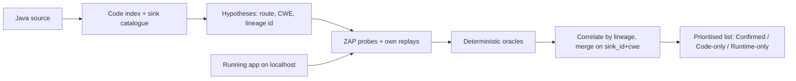
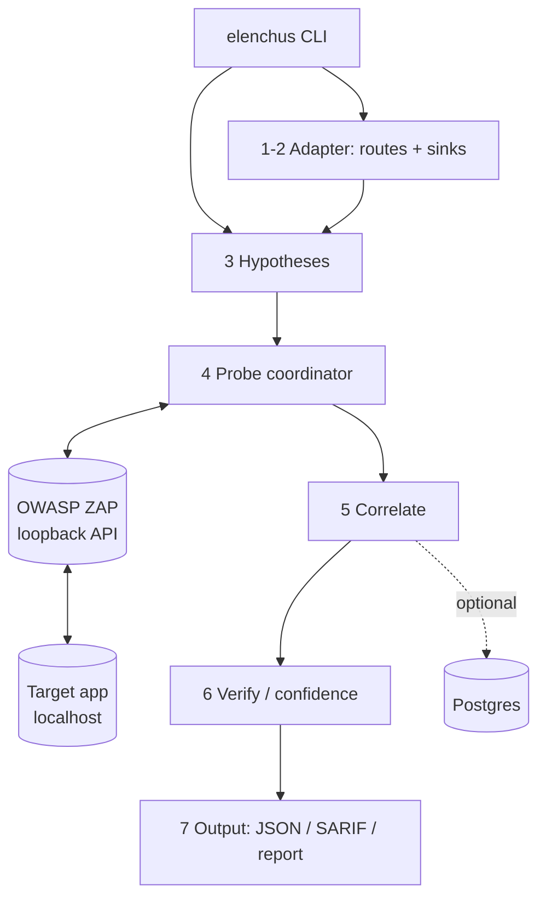

# elenchus — SAST + DAST Correlation

CyberForge hackathon entry. A Python CLI that scans a Java/Spring application's
**source code** (SAST) and its **running instance** (DAST), then **correlates**
the two so each real vulnerability appears once — with the code line that causes
it and the runtime proof that it is exploitable.

Full spec: [docs/prd.md](docs/prd.md). Design: [docs/architecture.md](docs/architecture.md). Current state: [docs/STATE.md](docs/STATE.md).

## Problem

Security teams run two kinds of scanners that never meet:

- **SAST** reads source code → "SQL injection at `orders.java:88`" but can't prove it is reachable.
- **DAST** attacks the running app → "SQL injection at `/api/orders?id=`" but can't say which code to fix.

The result is duplicate tickets, noisy false alarms, and no clear priority. The
challenge is to **link the runtime finding to the code that causes it**, merge
duplicates, and produce one prioritised list.

## How we solve it

**Static-guided dynamic testing with deterministic oracles.**

1. **Static analysis makes hypotheses.** An own tree-sitter code index + per-CWE
   YAML sink catalogue (anchored on low-level JDK/Spring APIs, never app names)
   finds sinks and walks the call graph back to the routes that reach them.
2. **ZAP probes, the project orchestrates.** OWASP ZAP's active scanner is the
   payload engine. Each probe carries a `hypothesis_id`, so a hit is **linked by
   lineage**, not matched afterward.
3. **Project oracles own the verdict.** Deterministic differential oracles
   (SQL error, command output, reflected XSS, open redirect, boolean-blind SQL)
   decide every verdict on a replayed response — a ZAP alert alone never does.
4. **Correlation + prioritisation.** Findings merge on `(sink_id, cwe)`; each
   issue is labelled Confirmed / Code-only / Runtime-only, scored, and ranked.

Safety: DAST targets `localhost` only, scoped to the route table; AI and Semgrep
are off by default and in judging mode; the whole run stays under 5 minutes.

### Methodology



### System architecture



## Run

```bash
# infra: ZAP (loopback API) + the target app, via Docker Compose
docker compose -f infra/zap.compose.yaml up -d
docker compose -f infra/vulnerableapp.compose.yaml up -d

# one command; judging profile = ZAP on, AI/Semgrep off, <5 min
export ZAP_API_KEY=...            # from the ZAP service
uv run elenchus scan --judging \
  --source-path .targets/VulnerableApp \
  --base-url http://127.0.0.1:9090/VulnerableApp
```

Open-source components (correlation logic is our own): **OWASP ZAP** (active
scanning), **tree-sitter-java** (parsing), optional **Semgrep** (offline
cross-check only).

## Results

Measured locally on **OWASP VulnerableApp**. Scores are against VulnerableApp's
own `expectedIssues` export (a superset spanning 30 CWE types); the organisers'
answer key will differ. "Supported" = the CWE classes the tool targets.

| Metric | Result |
|---|---|
| **Code detection (SAST), supported CWEs** | **23/35 (66%)** — clears the PRD "Good" bar (>60%) |
| &nbsp;&nbsp;SQL injection (CWE-89) | 9/9 |
| &nbsp;&nbsp;Cross-site scripting (CWE-79) | 11/19 |
| &nbsp;&nbsp;Command injection (CWE-77/78) | 2/2 |
| **Runtime detection (DAST)** | SQL-89, command-78, XSS-79, open-redirect-601 all confirmed live by project oracles |
| **Correct links** | 9/9 SQL-injection pairs linked as Confirmed |
| **Wrong links** | 0 |
| **Run time** | full judging scan < 4 min (< 5 min cap) |

Honest gaps (details in [docs/STATE.md](docs/STATE.md)): static XSS catches the
unescaped sinks but not escaped-yet-bypassable ones; open redirect and path
traversal are confirmed dynamically but have no safe general static anchor on
this app; full-sweep runtime coverage is bounded by ZAP active-scan throughput
within the 5-minute budget.
