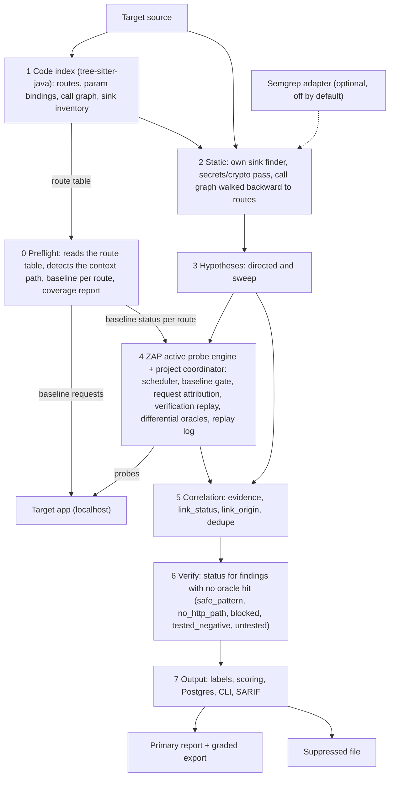
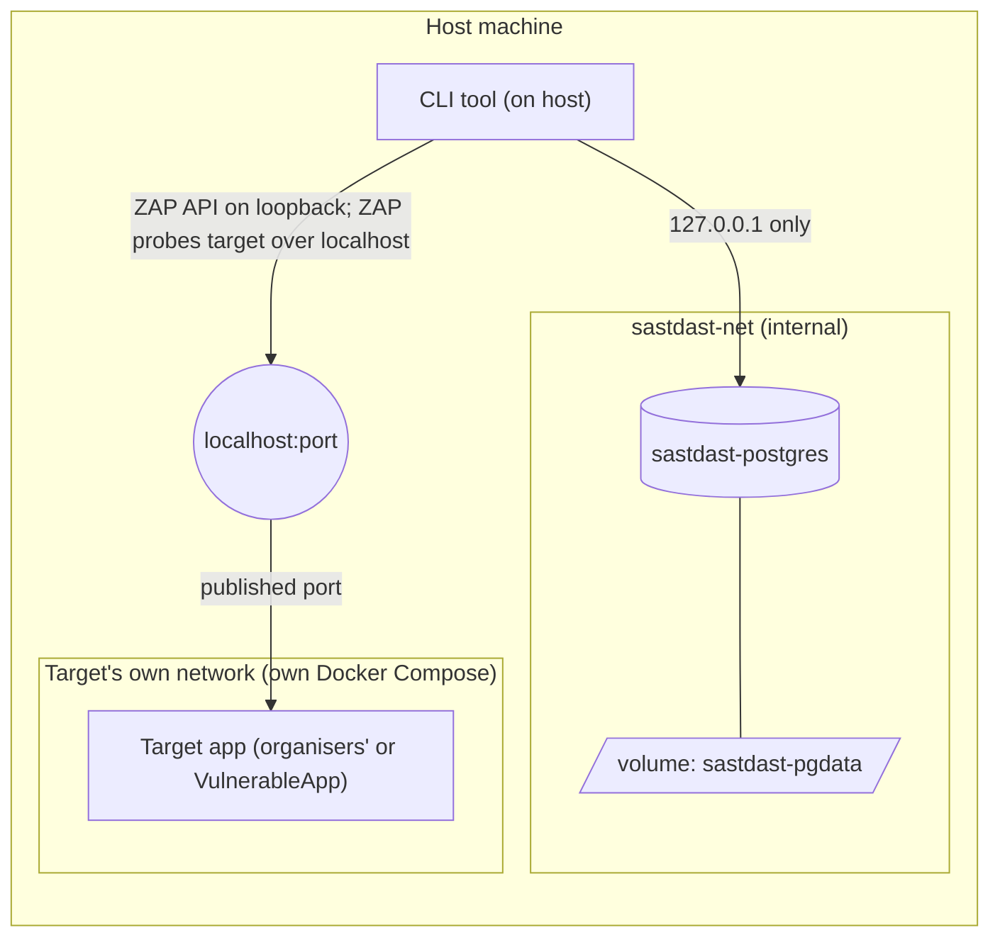

# Architecture

Status: target-state description. The stages below are a plan. Nothing here is claimed as built, tested or measured by this revision. How the code in the repo relates to this design: [implementation-plan.md](implementation-plan.md).

"Stage" in this doc means a pipeline stage, 0 to 7: what the tool does at run time. Build stages, `BS0` onward, are the order we build it in. They live in [implementation-plan.md](implementation-plan.md#build-stages).

## Core idea

Static-guided dynamic testing. Static analysis produces hypotheses. Dynamic testing probes them.

A directed hypothesis keeps its `hypothesis_id` through the probe and into the evidence. A directed hit is linked by lineage, not by matching afterwards.

What this does and does not buy:

- A firing probe proves that route, param and CWE are exploitable.
- It does not prove which sink on that route is the cause.
- Wrong links therefore move from bad matching to same-route sink ambiguity. This design marks that ambiguity. It does not remove it.

## Run model (local mode)

- The target app runs from its own Docker Compose on our machine: the organisers' app at judging, OWASP VulnerableApp for practice.
- Our tool is a Python CLI. It reads the target's source folder and scans the target on `localhost`.
- DAST targets `localhost` only. Any other host is disqualification.
- ZAP performs active scans against the already-running target. Use an isolated, disposable test instance; active requests may change application state. Localhost-only is a scope limit, not a sandbox. See [State guard](#state-guard).
- The ZAP API is bound to host loopback and is controlled locally by the CLI coordinator.
- One target framework per run.
- Our own stack (CLI + Postgres) runs separately from the target. See [Topology](#topology).

## Pipeline

Stage numbers are labels, not run order. The route table (stage 1, static, no network) is built first. Stage 0 runs against it, because the baseline requests and the context path probe both need the route table.

| Stage | Owner of the verdict | Output |
|---|---|---|
| 0 Preflight | Own code | Coverage report, baseline status per route |
| 1 Code index | Own code | Route table, param bindings, call graph, sink inventory |
| 2 Static | Own code | `(route, CWE, sink_id, call_path)` per finding, plus secrets and crypto findings |
| 3 Hypotheses | Own code | Directed and sweep hypotheses |
| 4 ZAP-backed probe | ZAP sends active-scan requests; project oracles own verdicts | Probe records with `hypothesis_id` and `ORACLE` evidence |
| 5 Correlation | Own code, deterministic | Linked issues with `link_status`, `link_origin` and confidence |
| 6 Verify | Own code, deterministic | `status` for every finding with no oracle hit |
| 7 Output | Own code | Labels, scores, Postgres rows, report, SARIF |

### Stage 0: Preflight

| Item | Level | Notes |
|---|---|---|
| Detect the context path | Must | See below. Never guessed silently. |
| One baseline request per mapped route | Must | Record 404, 401, 403, 400 and other statuses |
| Loopback check | Must | Stop if `target.base_url` does not resolve to loopback. |
| Coverage report | Must | Started here, finished after stage 6. See [Coverage report](#coverage-report). |
| Source-revision check | Best-effort | Works only if the app exposes git info, e.g. `/actuator/info` |
| `/actuator/mappings`, `/v3/api-docs` route discovery | Best-effort | Often not exposed. New routes enter the route table with `route_origin: discovered`. They have no handler, so they are sweep-only and can only produce Runtime-only hits. |
| Auth and CSRF detection | Best-effort | Records 401 and 403 routes. Sends credentials only if `target.auth.*` is set. |

None of the best-effort items is part of the spine.

Inputs and detection:

- Base URL (`target.base_url`): a required input, the CLI option `--target` or an environment variable `[TODO: variable name]`. Optional best-effort fallback: read published ports from a compose file in the source tree.
- Context path (`target.context_path`, auto-detected), in order:
  1. `server.servlet.context-path` in `application.properties` or `application.yml`.
  2. Probe: baseline the route table under candidate prefixes (the property value, empty, any prefix found in the source). Keep the prefix with the most non-404 baselines.
  3. If none works, stop with a coverage report that says so. Never guess silently.

### Stage 1: Code index

Own code, tree-sitter-java.

- Route table: route template, method, handler file, function, line span, `route_origin` (`source` or `discovered`). Reads composed annotations and mappings inherited from superclasses and interfaces.
- Param bindings: name, location, Java type. Covers `@RequestParam`, `@PathVariable`, `@RequestHeader`, `@CookieValue`, map getters, `getParameter`, and the fields of `@RequestBody` and `@ModelAttribute` DTOs read from source. Fields declared with Lombok are visible this way.
- `params_status` per route: `complete`, `partial` or `unknown`. A route with custom binders, converters or a DTO type outside the source tree is not `complete`.
- Call graph, multi-hop, with dependency-injection and interface-to-implementation cases resolved where simple.
- Sink inventory.
- Generated source folders are indexed when present in the source tree. Otherwise the gap is listed in coverage.
- Unresolved calls are flagged. They are never dropped.

### Stage 2: Static (Must)

- Own sink finder: tree-sitter plus a per-CWE YAML sink catalogue. It matches on call name and receiver type. No dataflow. Output: sink locations with `sink_id` and `arg_shape`.
- Own secrets and crypto pass: regex and entropy rules for hard-coded secrets (CWE-798), call-name rules for weak hashes and ciphers. Rules live in YAML.
- The call graph is walked backward from each sink to its entry routes. Output per finding: `(route, CWE, sink_id, call_path)`.

This gives route and call path. It does not say which param reaches the sink. The static stage never claims a param.

Catalogue rules:

- Each entry has a `kind`, because many Spring sinks are not calls:

| `kind` | Matches | Example |
|---|---|---|
| `call` | Call name and receiver type | `Statement.executeQuery` |
| `return_value` | A handler's returned string | `"redirect:" + url`, a `@ResponseBody` string |
| `annotation` | An annotation value | A native query string |
| `template` | Markup in a template file | `th:utext`, JSP expression output |
| `xml` | A mapper file | MyBatis `${}` |

- Anchor entries on low-level APIs. A wrapper inside the target's source is then still found through the sink inside it, and the backward walk reaches its callers. The remaining wrapper risk is third-party wrappers and unresolved call chains. Third-party wrappers get their own entries.
- Each entry records the API it came from. No entry names a class, route or module of a test app.

`arg_shape` is a syntax check on the sink's argument at the call site. It is not dataflow.

| `arg_shape` | Rule | Effect |
|---|---|---|
| `constant` | A literal, a concatenation of literals and constants, or a local variable assigned exactly once from one of those | No directed hypothesis. Status `safe_pattern`. |
| `sanitised` | The argument is a direct call to a sanitiser catalogued for that CWE and output context | No directed hypothesis. Status `safe_pattern`. |
| `dynamic` | Anything else, including anything the check cannot read | Normal directed hypothesis |

Unknown always means `dynamic`. The route is still swept, so a wrong `safe_pattern` can still be caught at run time by the [conflict rule](#conflict-positive-oracle-versus-a-suppressed-sink).

Recall comes from catalogue growth and measurement, not from the flow engine. M1 and M2 recall does not depend on the flow engine. The PRD's 85% code-detection figure is a target, not a claim. See [Measurement](#measurement).

Semgrep is not part of the pipeline. It is an optional adapter, off by default, enabled by the config flag `semgrep.enabled`. Uses:

| Use | Purpose |
|---|---|
| Fallback sink source | For a non-Java target, until the own finder has an adapter |
| Cross-check | Sinks that both tools flag are marked corroborated |
| Benchmark yardstick | Run offline, outside the pipeline |

The pipeline and its tests must pass with Semgrep not installed.

Own flow engine: Should, built after M2. It narrows `candidate_params` from all to the specific param. It never blocks M1 or M2. Gate for making it the default: it matches the measured Semgrep count on VulnerableApp, with Semgrep run offline as the yardstick. `[TODO: Semgrep count on VulnerableApp with unfitted rules; record count, date and rule version in STATE.md]` The earlier figure came from rules partly fitted to VulnerableApp and overstates generality.

Strict mode matches only when the receiver type resolves. Call sites that match a catalogue name with an unresolved receiver stay in the index and are never dropped. Only the relaxed back-guided search uses them. There is no fallback in strict mode. The coverage report counts these call sites. If the count is material after M1, revisit. There is no flag for it.

### Stage 3: Hypotheses

| Kind | Content | Purpose |
|---|---|---|
| Directed | `(route, CWE, sink_id, call_path)` with `candidate_params` = all params of the route | The probe tries each param. The oracle shows which one fires. |
| Sweep | Every injectable param by every supported class | Bugs static analysis missed |

Stage 3 emits one Hypothesis record type for both sets. Sweep skips a param whose declared Java type cannot carry a payload: numeric, boolean, UUID or enum. Directed hypotheses never skip it. Skipped params are listed in coverage.

Hypotheses are not jobs. The coordinator groups hypotheses into ZAP jobs in stage 4.

### Stage 4: ZAP-backed probe engine

OWASP ZAP's active scanner generates and sends attack requests. Project-owned code coordinates ZAP through its local API, applies the baseline gate, records which hypotheses each job covers, attributes each request, replays candidate hits and applies deterministic oracles. A ZAP alert by itself is not a runtime verdict.

| Part | Behaviour |
|---|---|
| Job construction | One ZAP active-scan job per `(route, method)`. Jobs run one at a time. Before a job starts, the coordinator records a `ProbeJob`: job id, route, method, covered `hypothesis_ids`, CWEs, seed request and canary. |
| Scan scope | The ZAP context is built from exact route-table patterns, not the whole base path. No recursion. Input vectors are limited to the param locations in the index. The URL-path vector stays off unless the route has a path param, because it mutates every segment, including the context path. When it is on, an excluded-param rule limits it to the param's seed value. |
| Seeding | The seed request goes through ZAP's proxy port before the scan. A scan can only start from a site-tree node, and `core/action/sendRequest` does not add a POST to the tree. |
| Scan policy | An allow-list. Only the rule IDs in `zap.rule_map.<cwe>` for the job's CWEs are on. Out-of-band and SSRF rules stay off. |
| Typed seeds | Supply valid route and parameter values from the index. ZAP generates attack variants. AI repair is Should, only after non-AI seeds work. |
| Baseline gate | Take a fresh baseline right before each job. A param whose baseline fails is excluded from the job and recorded as `blocked_by_validation` with a sub-code: `validation` (400, 422), `auth` (401, 403), `not_found` (404), `server_error` (5xx), `other`. If every param fails, the job does not start. |
| Hypothesis lineage | The `ProbeJob` record is written before the scan, so lineage does not depend on matching afterwards. A hit's hypotheses are the job's hypotheses with the hit's CWE and param. |
| Request attribution | Every message is attributed from the request itself. See [Request attribution](#request-attribution). |
| Verification replay | Every candidate hit is replayed by the coordinator after its job ends. The project oracle's result on the replay is the verdict. See [Verification replay](#verification-replay). |
| Probe header | `X-Elenchus-Probe: <job canary>` on every ZAP request, set by a Replacer rule that changes per job `[verify in BS0; fallback: an HTTP Sender script]`. A message without the header is not evidence. |
| Canaries | The job canary in the header ties traffic to the job. ZAP's own payloads do not contain our canary, so the payload canary is added only at verification replay. |
| Replay log | Capture full request/response messages for candidate hits and replays, with job id, scan id, rule id and hypothesis ids. Store references and redact secrets. |
| Header and cookie checks | Project-owned deterministic checks over responses observed by ZAP. Covers the planted runtime-only class and needs no sink link. |
| Auth | Optional `target.auth.*`: a static header or cookie, value read from an environment variable, sent by a Replacer rule. Without it, auth-gated routes are `blocked` with sub-code `auth`. Login automation stays with the session manager (Should). |
| Session manager | Should. Moves to M2 only if kickoff shows the app needs a login. |
| App-log tail | Could. Never in judging mode. |

Oracles are differential: each compares a probe response with the route/parameter baseline. An alert without required response evidence is not confirmed.

#### Request attribution

ZAP alerts do not carry a `hypothesis_id`, so alerts are not the source of attribution. For each finished job, the coordinator reads every message through `ascan/view/messagesIds` and:

1. Drops the message if the probe header, job canary or rule header is missing, or if the URL does not normalise to the job's route. ZAP sends one random-path request per job for its own 404 analysis. It has no rule header, so this step drops it.
2. Finds the **param** by diffing the request against the job's seed request.
3. Finds the **CWE** from the rule ID in `X-ZAP-Scan-ID` (ZAP's inject-plugin-id option), through `zap.rule_map.<cwe>`.
4. Runs the project oracle for that CWE on the response. An oracle match or a ZAP alert on the message makes it a candidate hit. Alerts are hints only.

If the diff shows zero params or more than one, the message cannot support a directed link. A hit from it stays unlinked. Never manufacture directed lineage.

A candidate on a CWE or param with no directed hypothesis in the job is a sweep hit.

`BS0` confirmed the mechanism on a small set of VulnerableApp routes. Its accuracy across a full run is measured from `BS4` on.

#### Verification replay

- Replay each candidate up to `replay.count` times through `core/action/sendRequest`, with redirects off, the probe header on and no other job running.
- It counts as confirmed when the oracle fires on at least `replay.min_hits` replays.
- The coordinator adds the payload canary to ZAP's attack string where the oracle needs it, and sends boolean pairs and timing repeats itself. This is why timing is measured with no other traffic.
- A candidate that does not reproduce gets `oracle_flaky: true` in the replay log and creates no hit.
- Replays use the reserved replay budget. A candidate not replayed before that budget ends is not confirmed. Its finding stays `untested`, and coverage counts it.

#### Scheduler

The budget is a deadline, not a job count, because job durations vary. Values: [Config reference](#config-reference).

1. **Pass 1:** routes with directed hypotheses, using only the rules for those CWEs, at `zap.attack_strength.directed`.
2. **Pass 2:** sweep the remaining classes on every route, with the time left, at `zap.attack_strength.sweep`. Skip any `(route, param, CWE)` already confirmed.

Within each pass, order follows the [state guard](#state-guard).

- The coordinator stops a job at `probe.max_job_seconds` with `ascan/action/stop`. ZAP's own scan limit is in whole minutes, so it is too coarse to rely on.
- `probe.max_jobs` is a safety limit only.
- Jobs not run are recorded in coverage. Their findings can only be `untested`, never `tested_negative`.
- Whatever the budget does not reach is reported as a gap. A missed job is never reported as a clean result.

#### State guard

Judging allows no restarts, and active scans can change data mid-run. A read-only rule would skip every POST bug, and a reset would break the no-restart rule, so the rule is risk ordering plus a stop condition.

1. Order jobs: GET, then POST, then PUT and PATCH, then DELETE.
2. Within that order, run last any route whose static findings hold an `UPDATE`, `DELETE`, `DROP` or `TRUNCATE` literal.
3. After each state-changing job, re-request up to `probe.drift_routes` GET routes that had a valid baseline.
4. On drift (a route that was valid now returns 5xx or 404): stop state-changing jobs, mark the rest `untested`, and report the drift in coverage.
5. Never assign `tested_negative` to a finding probed after drift.

This limits damage. It does not prevent it: a tautology payload can still change data. Practice mode may restart the target between runs. Judging mode never does.

#### Scan safety checks

- At run end, compare the hosts in ZAP's history with loopback. Any other host fails the run loudly and is reported. An open-redirect payload that gets followed is the case this guards against.
- Replays never follow redirects.

| Class | Oracle |
|---|---|
| SQL injection | Error signature, boolean pair, or timing with repeats |
| XSS | The attack value's markup returned verbatim in a `text/html` response, absent from the baseline. Decision (BS6): a `text/plain` response is not confirmed, because a browser does not render it as HTML. Such a route is untested for XSS, not negative. ZAP raised no alert on VulnerableApp's `text/plain` XSS routes. |
| Command injection | Output marker first, timing with repeats as the fallback |
| Path traversal | File-content marker `[proposed: a Linux passwd line pattern, since no canary file can be planted in the organisers' target]` |
| Open redirect | `Location` header host |

Path traversal (CWE-22) is Should, M3, the first item after M2. With the secrets pass it covers all six PRD vulnerability types.

ZAP is the required active-scan engine in practice and judging mode. Its passive analysis may also inspect observed responses. In both cases, the project's deterministic oracles—not ZAP's risk label alone—own the verdict.

### Stage 5: Correlation

Evidence types: `PATH`, `ORACLE`, `TRACE`, `RESPONSE_TRACE`, `FAMILY`, `ADEQUACY`. Definitions in [finding-schema.md](finding-schema.md#linking-and-ambiguity). `TRACE` exists only when the optional log tail runs. It is not available in judging mode.

After an oracle fires, hypotheses are grouped by `(route, param, CWE)`.

| Group size | `link_status` | Result |
|---|---|---|
| One | `unique` | Linked by lineage |
| More than one | `ambiguous` | Lower confidence. All candidate sinks attached as `alternatives`. One primary chosen. |

Two link fields. Both are required and orthogonal.

| Field | Values | Meaning |
|---|---|---|
| `link_status` | `unique`, `ambiguous` | How many candidate sinks the link has |
| `link_origin` | `directed`, `sweep`, `back_guided` | How the link was produced |

`link_origin` alone would hide ambiguity on sweep links. A sweep hit is matched to static candidates with the same CWE whose `entry_paths` include the hit route and whose `candidate_params` include the hit param.

- Primary rule: strict catalogue matches before relaxed matches, then shorter call path, then corroboration when Semgrep ran, then normalized source file/line/column order. A match on receiver type and call name is more specific than a match on call name alone.
- `TRACE` resolves ambiguity when present.
- `RESPONSE_TRACE` can resolve ambiguity, including in judging mode. If a verification replay's response holds a stack trace, the adapter's frame parser turns it into generic frames, and correlation compares them with the group's sinks. Correlation itself stays framework-free.

| Stack trace result | Effect |
|---|---|
| The first project frame in Java stack order (deepest call) is in the enclosing method of exactly one candidate | That candidate is primary. `link_status: unique`. |
| The deepest project frame is in a method with no known sink | No upgrade. Lower confidence. Logged as a catalogue gap. This partly addresses the third-sink flaw. |
| No stack trace, or several candidates in that method | No change. The link stays as it was. |

- Sweep hits (oracle fired, no directed hypothesis): matched to static findings by route and param with `link_origin: sweep`, lower confidence. `safe_pattern` and `tested_negative` sinks are matched only by the conflict rule. Otherwise see [Back-guided static search](#back-guided-static-search).
- Confidence is a float from 0 to 1, a deterministic function of the evidence present, `link_status` and `link_origin`. Bands and weights live in config ([Config reference](#config-reference)). The cut points are tuned on `expected_pairs` runs. Each factor is stored in `confidence_reasons`, a list of `{factor, delta}` written by the engine.
- `sink_id` for the Must set is `(file, enclosing_method, start_line, start_col)`. Refining it to `(method, call-site ordinal, arg index)` is Could.
- Dedupe key is `(sink_id, cwe)` `[proposed]`. The resolved param is an attribute. Several firing params on one sink are several evidence entries on one issue. Findings with no `sink_id` use the fallback keys in [finding-schema.md](finding-schema.md#contract-logic). Header findings follow config `header.count_mode` `[TODO: confirm at kickoff against the answer key]`.
- One sink reached from several routes is one issue with several `entry_paths`. Config `export.count_multi_entry` decides how the export counts it `[TODO: confirm at kickoff against the answer key]`.

### Back-guided static search

Tier: Should. Config `backguided.enabled`, off until measured. Values: [Config reference](#config-reference).

Purpose: for a runtime-only hit (sweep, oracle fired, no hypothesis), try to attach a code location.

Strict mode (receiver type resolved, same catalogue) is already covered by the stage 2 directed hypotheses. It is not a separate pass. This pass exists for relaxed mode only.

Relaxed mode:

- Match the call name alone when the receiver type is unresolved.
- Walk through unresolved calls up to `backguided.max_unresolved_hops`. Record the count in `unresolved_hops`.
- Every match carries `match_mode: relaxed`.

Method: start at the hit route's handler, walk the call graph forward, look for sinks of the same CWE.

| Candidates of the same CWE reachable from the handler | Result |
|---|---|
| Exactly one | Attach as `PATH` evidence. `link_origin: back_guided`, `link_status: unique`. Confidence starts at `backguided.start_confidence` and loses `backguided.hop_penalty` per unresolved hop. Label Confirmed only if confidence is at or above `backguided.min_confidence_to_confirm`. Below that, the label stays Runtime-only and the candidate stays attached. |
| More than one | Label stays Runtime-only. `link_status: ambiguous`. Candidates go in `candidate_sinks` as hints. No Confirmed link is exported. |
| None | Stays Runtime-only. `unlinked_reason` set. |

Rules:

- With the defaults in the Config reference, one unresolved hop leaves the confidence at or above the threshold. Two or more fall below it, and the finding stays Runtime-only.
- Never runs for header, cookie or info-leak findings.
- A back-guided link never overrides a directed link on the same issue `[proposed]`.
- Producer entry: `run_back_guided(target, route_map, runtime_only_findings)`. It reads the index and sink catalogue. The CLI calls it after the probe stage and passes the result to correlation `[proposed order]`.
- Measurement: run VulnerableApp with it on and off against `expected_pairs`. If it adds no correct links, or adds any wrong link, leave it off.

### Stage 6: Verify and negative evidence

Status is assigned in this order:

1. An oracle fired: the finding is linked. It has no unconfirmed status.
2. `arg_shape` is `constant` or `sanitised`: `safe_pattern`.
3. No route reaches the sink: `no_http_path`, with a reason code.
4. Any candidate param is `blocked_by_validation` and no oracle fired: `blocked`.
5. The [adequacy test](#adequacy-test) passes: `tested_negative`.
6. Otherwise (budget spent, not attempted, params incomplete, or probed after drift): `untested`.

| `status` | Rule | Report |
|---|---|---|
| `safe_pattern` | 2 | Suppressed (PRD bonus B-2), if the CWE is in `export.suppress_cwes` |
| `no_http_path` | 3 | Primary report, Code-only, reason code shown. Suppressed only if eligible (below). |
| `blocked` | 4 | Primary report, Code-only |
| `tested_negative` | 5 | Suppressed (PRD bonus B-2), if the CWE is in `export.suppress_cwes` |
| `untested` | 6 | Primary report, Code-only |

If the CWE is not in `export.suppress_cwes`, a `safe_pattern` or `tested_negative` finding keeps its status and stays in the primary report as Code-only.

The per-param probe outcomes and the `blocked` sub-code are recorded in `unlinked_reason`. Blocked or untested never means safe.

The adequacy logic and the suppressed file are M2. The suppressed file has real content in M2, not an empty placeholder.

#### Adequacy test

A negative result must prove the probe reached the code. `tested_negative` requires all of these:

- `params_status` is `complete` for the route.
- The job ran before any drift and was not stopped early.
- Every candidate param has one of these two outcomes:

| Param outcome | Rule |
|---|---|
| `adequate` | The baseline was valid, every rule in `zap.rule_map.<cwe>` mutated the param, and at least one mutated request got past validation (not 400, 401, 403, 404 or 422) |
| `type_rejected` | The baseline was valid, every mutated request returned 400 or 422, and the declared Java type is numeric, boolean, UUID or enum |

If every mutated request on any other param returns a rejection, the outcome is `blocked_by_validation`, sub-code `validation`.

The coordinator records the per-route, per-param, per-CWE result as `ADEQUACY` evidence on the corresponding static finding. It includes expected and observed ZAP rule IDs and mutated response statuses. Stage 6 may assign `tested_negative` only if every parameter on every entry route has a completed, non-drifted job and an `adequate` or `type_rejected` outcome. Missing evidence is `untested`.

A negative result is not proof that a query is parameterised. It is measured by `wrong_suppression_count`: if the count is above zero for a CWE, remove that CWE from `export.suppress_cwes`. See [Measurement](#measurement).

`no_http_path` reason codes:

| Code | Meaning |
|---|---|
| `no_callers` | The backward walk found no caller |
| `walk_unresolved` | The walk stopped at an unresolved call |

- Only `no_callers` findings in injection CWEs are ever eligible for suppression, under `export.suppress_no_http_path`. `walk_unresolved` findings and secrets/crypto findings (CWE-798 and similar) are never suppressed. Secrets and crypto findings are Code-only by nature and are never labelled `no_http_path`.
- PRD bonus B-2 names code that no URL can reach as a safe marker, so the flag exists. It stays off until measured.
- Tradeoff: suppression cuts false alarms. It lowers code-detection recall if the probe missed a real bug. `[TODO: measure with the same protocol as export.include_alternatives (see STATE.md), then set the default.]`

### Conflict: positive oracle versus a suppressed sink

Case: an `ORACLE` hit matches the `(route, param, CWE)` of a sink marked `tested_negative` or `safe_pattern`.

A sink with `arg_shape: constant` cannot be the cause, because no input reaches its argument. The hit stays Runtime-only with `conflict: true`, the sink is listed in `candidate_sinks` as a hint, and the sink stays `safe_pattern`. The rest of this rule applies to `tested_negative` and to `arg_shape: sanitised`, where the sanitiser may not fit the output context.

1. Replay the probe up to `replay.count` times.
2. Fires in at least `replay.min_hits` replays: un-suppress the finding and clear its status. Set `link_origin: sweep`, `link_status: ambiguous` and `conflict: true`. Record the reason "directed probes negative, positive hit on replay". Lower the confidence. Move it to the primary report. Then apply the threshold `backguided.min_confidence_to_confirm`, the same one used by back-guided search:
   - At or above it: label Confirmed, with `sink_id` set.
   - Below it: label Runtime-only. Keep `conflict: true` and `link_status: ambiguous`. Set `sink_id` to null and list the sink in `candidate_sinks` as a hint. Export no Confirmed link. The oracle hit is real, so it is not suppressed. It is not confident enough to claim a code location. A conflict case will usually fall below the threshold, so it usually exports as Runtime-only with `conflict: true`.
3. Does not reproduce: keep the status. Set `oracle_flaky: true` on that evidence entry. Create no link. The hit stays Runtime-only.

Rationale: a positive oracle is stronger evidence than a failed probe. One unconfirmed hit is not enough to override an adequately tested negative.

### Stage 7: Output

- Labels: Confirmed, Code-only, Runtime-only.
- Scoring from config: CWE severity table, exploit factor, evidence-based link factor.
- Postgres, CLI report, SARIF at the boundary, VulnerableApp benchmark adapter.
- Measurement: a hand-made expected-pairs file for VulnerableApp. Each pair: route, param, CWE, sink file, sink line. `[proposed path: common/fixtures/expected_pairs/vulnerableapp.yaml]`. It measures correct-link and wrong-link rates, because the grader scores SAST and DAST separately. It is used for measurement only and never feeds scanner logic. Replace or extend it with the organisers' answer key at kickoff.

### Graded export and suppressed file

| Output | Contents |
|---|---|
| Primary report | Every finding except `suppressed`. Alternative sinks are attributes of the primary issue, not separate issues. |
| SAST grader payload | Every finding except `suppressed`. Primary and alternative sinks both, controlled by `export.include_alternatives`. |
| Suppressed file | Suppressed `tested_negative` and `safe_pattern` findings, each with its reason. |
| Coverage report | What the run did not or could not test. See [Coverage report](#coverage-report). |
| Postgres | Everything, including suppressed findings. |

Config flag `export.include_suppressed` merges the suppressed findings into the graded export.

Alternative sinks go in the grader payload because code detection is scored from that export, and the planted bug may be the alternative. `[TODO: measure false alarms and code detection with export.include_alternatives on and off on VulnerableApp against expected_pairs, then set the default.]`

### Coverage report

Every run writes one. It states this line at the top: "Blocked or untested does not mean safe."

| Section | Contents |
|---|---|
| Routes | Mapped, discovered, unreached, and blocked by sub-code. The context path result. |
| Params | Routes whose `params_status` is not `complete`. Params the tool could not build. Params the sweep skipped by type. |
| Classes | Classes this run does not test: IDOR, business logic, blind SSRF, XXE, and any supported class turned off. |
| Static gaps | Unresolved call sites that matched a catalogue name. `walk_unresolved` sinks. Generated code not indexed. Catalogue gaps seen in stack traces. |
| Probe gaps | Jobs skipped by budget or drift. Jobs stopped at the limit. Candidates not replayed. |
| Attribution | The measures in [Measurement](#measurement) for this run. |
| Safety | Drift events. Hosts seen in ZAP history. |

## Measurement

Nothing below has been measured yet. Report each on VulnerableApp against `expected_pairs` and its expected-issues file. Record results in [STATE.md](STATE.md).

| Measure | Definition | Rule |
|---|---|---|
| Recall per CWE | Planted issues found, per CWE, with each miss listed and tagged: `no_catalogue_entry`, `route_missing`, `walk_unresolved` or `param_unbuildable` | The stated baseline. The PRD's targets stay targets until this exists. |
| Supported and raw score | Score on the CWEs we support, shown beside the raw score on all CWEs | Always print both. The supported score alone is not comparable to the PRD metric. |
| `attribution_rate` | Candidate hits tied to one job and one param, divided by all candidate hits and alerts | Also list the unattributed ones. |
| `attribution_accuracy` | Attributed hits whose route, param and CWE match `expected_pairs`, divided by attributed hits with a matching pair | A high rate can still be wrong, so both are required. |
| `header_propagation_rate` | Messages with the probe header and job canary, divided by all job messages | Below 100% means the header claim fails. Report it. |
| Ambiguity rate | Linked issues with `link_status: ambiguous`, divided by all linked issues, and how many `RESPONSE_TRACE` resolved | Report it. Do not hide it. |
| `wrong_suppression_count` | Planted issues with a suppressed status, per CWE | Above zero: remove that CWE from `export.suppress_cwes`. |
| Decoy result | Each decoy fixture's status against the required status in [the decoy plan](implementation-plan.md#decoy-test-plan) | Any decoy reported, or any vulnerable twin suppressed, is a failure. |
| Time | Wall time per stage, jobs run, jobs skipped | Set budget values from this. |

VulnerableApp has no secrets module. Secrets recall is measured on our own static fixtures, not on VulnerableApp.

Reaching a target on VulnerableApp does not show generality. See [Generality](#generality).

## Generality

The PRD's unseen app is a separate proof. These rules apply before judging:

| Rule | Enforcement |
|---|---|
| No VulnerableApp route, module or class name in tool code or the catalogue | A CI test fails on a match. The banned list is kept in the test. |
| Every catalogue entry names the API it came from | Catalogue format and a CI test |
| The catalogue is frozen before kickoff | Changes after the freeze are recorded in [STATE.md](STATE.md). A change based on the test app's results is recorded as fitted. |
| No assumed context path, port, seed value or param name | Rehearse with only `--target` and the source path as inputs |
| Hold-out check | Run stages 1 and 2 on another public Spring repo. **Static only.** Dynamic scanning is limited to the organisers' app and VulnerableApp. |

No hold-out result proves the unseen-app target. It only exposes parser and catalogue assumptions early.

## ZAP acceptance check

Build stage `BS0`, run with [scripts/bs0_zap_check.py](../scripts/bs0_zap_check.py) against ZAP 2.17.0 (the digest in [infra/zap.compose.yaml](../infra/zap.compose.yaml)) and the VulnerableApp digest in [infra/vulnerableapp.compose.yaml](../infra/vulnerableapp.compose.yaml). The results below are from the final run on 2026-10-31: 16 jobs over a handful of routes. It says nothing yet about a full scan.

| # | Must show | Result | Decision |
|---|---|---|---|
| 1 | `ascan/view/messagesIds` returns only the messages of one scan | Pass. No message ID appeared in two of the 16 jobs. | One job per `(route, method)` |
| 2 | `X-ZAP-Scan-ID` is on every active-scan request, and gives the rule | Pass, except one 404-analysis request per job, which has none | Drop messages with no rule header |
| 3 | A Replacer rule adds the probe header to active-scan traffic | Pass. Every message had the right job canary. | Replacer, not HTTP Sender |
| 4 | Query, form, path and JSON params can each be mutated, and each diff finds the param | Pass on all four. Each job had at most one message changing more than one param, which by count matches the 404-analysis request. Some rule-sent messages match the seed exactly and carry no evidence. Path needs the scoping below. | Path vector off by default, scoped when needed |
| 5 | `core/action/sendRequest` can replay with redirects off | Pass. It returned the 302 and did not follow it. | Replay through ZAP |
| 6 | The rule IDs in `zap.rule_map.<cwe>` exist in the pinned version | Pass | Time-based SQL rules added to the map |
| 7 | Real time per job, at each attack strength, on VulnerableApp | 0.5 to 1.5 seconds per job at LOW and MEDIUM, where 0.5 is the polling floor. 3 to 25 messages per job. | Budgets stand. A vulnerable route with a time-based payload will take longer. |
| 8 | ZAP history shows loopback hosts only after an open-redirect scan | Pass. `core/view/hosts` listed only `127.0.0.1`. This reads ZAP's own record, not network traffic. | Keep the run-end host check |

Other findings:

- A POST seed must go through ZAP's proxy port. See Seeding in [Stage 4](#stage-4-zap-backed-probe-engine).
- With the path vector on and unscoped, ZAP mutated the context path (`/'/ErrorBased...`), which leaves the route table. With an excluded-param rule, it mutated only the param's segment.
- ZAP's one 404-analysis request per job goes to a random sibling path, on the same host. It carries no payload. It is the one known request outside the route table.
- ZAP raised alerts on the SQL query, command injection and redirect routes tried, and none on the form, JSON, XSS or traversal routes tried. Which of those routes are really vulnerable to the payloads ZAP sent was not checked here. VulnerableApp lists the XSS and traversal routes as vulnerable, which supports treating alerts as hints only.

## Judging mode

The organisers run the target at judging. A separate config profile applies.

| Rule | Value |
|---|---|
| Log tail | Off |
| Target restarts | None |
| State changes | [State guard](#state-guard): risk ordering, drift check, stop on drift |
| Required input | The target base URL: `--target` or an environment variable. The context path and routes are detected. `target.auth.*` is optional. |
| Profile | `judging.profile` forces `semgrep.enabled`, `logtail.enabled` and `ai.enabled` to false. ZAP active scanning remains enabled and bounded by the stage budget. |
| Command | One |
| Time budget per stage | `probe.stage_budget_seconds.<stage>`. Proposed values in the Config reference. Final values come from `BS0` and `BS6` measurements. |
| AI | Off |
| ZAP | On: required active probe engine |
| Semgrep | Off |
| `TRACE` evidence | Unavailable. Ambiguous links stay ambiguous. |
| Total runtime target | Under 5 minutes |

The base URL is the only required input. Everything else is detected. Nothing is assumed.

## Config reference

The single source for config names and default values. Other docs point here and do not repeat values. Keys are dotted lower_snake. Defaults are in brackets. Unmeasured values stay TODO. Back-guided and band values are `[proposed]` until tuned on `expected_pairs` runs.

| Key | Default | Purpose |
|---|---|---|
| `target.base_url` | [required] | Target app base URL on localhost |
| `target.source_path` | [required] | Target source folder |
| `target.context_path` | [auto-detected] | Servlet context path. See Stage 0. |
| `target.auth.header_name` | [none] | Optional header or `Cookie` sent on every request to the target |
| `target.auth.value_env` | [none] | Environment variable holding that header's value. Never commit or print it. |
| `judging.profile` | [false] | When true: forces `semgrep.enabled`, `logtail.enabled` and `ai.enabled` to false, requires ZAP active scanning, and allows no target restarts |
| `semgrep.enabled` | [false] | Optional Semgrep adapter |
| `zap.enabled` | [true] | Required ZAP active scan engine and passive response analysis. Must stay enabled in judging mode. |
| `zap.api_url` | [`http://127.0.0.1:8090`] | Local ZAP API endpoint. Must be host loopback; never expose it to an untrusted network. |
| `zap.api_key` | [`ZAP_API_KEY` environment variable] | Local API access key. Never commit or print it. |
| `zap.version` | [2.17.0, digest in `infra/zap.compose.yaml`] | The ZAP image the acceptance check ran against. Re-run `BS0` when it changes. |
| `zap.rule_map.<cwe>` | [89 = 40018, 40019, 40020, 40021, 40022, 40027; 79 = 40012; 78 = 90020; 22 = 6; 601 = 20019] | ZAP rule IDs allowed for each CWE. Maps a rule ID back to its CWE. All exist in the pinned version. |
| `zap.attack_strength.directed` | [proposed: MEDIUM] | Attack strength in scheduler pass 1 |
| `zap.attack_strength.sweep` | [proposed: LOW] | Attack strength in scheduler pass 2 |
| `zap.thread_per_host` | [2] | ZAP threads per host within one job. The value `BS0` ran with. |
| `logtail.enabled` | [false] | App-log tail for `TRACE` evidence |
| `ai.enabled` | [false] | Master AI switch |
| `ai.max_calls` | [30] | Cap on AI calls per run |
| `ai.tasks.<name>.enabled` | [false] | Per-task AI switch |
| `probe.max_job_seconds` | [proposed: 30] | The coordinator stops a job at this limit. `BS0` jobs took under 2 seconds. The margin allows for a time-based payload that actually sleeps. |
| `probe.max_jobs` | [proposed: 60] | Safety limit on jobs per run. The deadline is the real budget. |
| `probe.drift_routes` | [proposed: 3] | GET routes re-requested after a state-changing job |
| `probe.timing_repeats` | [TODO] | Repeats for timing oracles |
| `probe.stage_budget_seconds.index_static` | [proposed: 30] | Stages 1 to 3 |
| `probe.stage_budget_seconds.preflight` | [proposed: 20] | Stage 0 |
| `probe.stage_budget_seconds.zap_jobs` | [proposed: 170] | Stage 4 ZAP jobs |
| `probe.stage_budget_seconds.replay` | [proposed: 40] | Stage 4 verification replays. Reserved, so ZAP jobs cannot spend it. |
| `probe.stage_budget_seconds.output` | [proposed: 20] | Stages 5 to 7. The stage budgets total 280 seconds, leaving 20 as margin under 5 minutes. |
| `replay.count` | [3] | Replays of a candidate hit, and of a probe in the conflict rule |
| `replay.min_hits` | [2] | Replays that must fire to count as reproduced |
| `flow.enabled` | [false] | Own flow engine narrows candidate_params; off until it matches the offline Semgrep count |
| `backguided.enabled` | [false] | Back-guided static search |
| `backguided.max_unresolved_hops` | [3] | Unresolved calls the search may walk through |
| `backguided.start_confidence` | [0.55] | Confidence of a unique back-guided match |
| `backguided.hop_penalty` | [0.1] | Confidence lost per unresolved hop |
| `backguided.min_confidence_to_confirm` | [0.4] | Lowest confidence exported as Confirmed for back-guided and conflict links |
| `confidence.band.low_max` | [0.4] | Upper bound of the low band. The low band is below it. |
| `confidence.band.high_min` | [0.7] | Lower bound of the high band. The medium band is between the two. |
| `confidence.weight.oracle_fired` | [proposed: 0.5] | Added to a link's confidence when an oracle fired |
| `confidence.weight.path_exists` | [proposed: 0.2] | Added when a code path from an entry route to the sink exists |
| `confidence.weight.unique_link` | [proposed: 0.15] | Added when the `(route, param, CWE)` group has one sink |
| `confidence.weight.ambiguous_penalty` | [proposed: -0.25] | Added when the group has several sinks |
| `confidence.weight.catalogue_gap_penalty` | [proposed: -0.1] | Added when the deepest project frame has no candidate sink |
| `confidence.weight.family_match` | [proposed: 0.1] | Added when the payload family matches the sink's CWE family |
| `export.include_alternatives` | [true] | Alternative sinks in the SAST grader payload |
| `export.include_suppressed` | [false] | Suppressed findings in the graded export |
| `export.suppress_cwes` | [proposed: 79, 78, 601, 22] | CWEs whose `tested_negative` and `safe_pattern` findings may be suppressed. CWE-89 was removed after the live run suppressed four planted SQL injection sinks. Remove any CWE when `wrong_suppression_count` is above zero. |
| `export.suppress_no_http_path` | [false] | Suppress eligible `no_http_path` findings |
| `export.no_http_path_suppress_cwes` | [22, 78, 79, 89, 601] | CWEs eligible for `no_callers` suppression only. Secrets/crypto and unresolved walks are never eligible. |
| `export.count_multi_entry` | [TODO: confirm at kickoff against the answer key] | How the export counts one sink reached from several routes |
| `header.count_mode` | [per_app] | `per_app` or `per_url` `[TODO: confirm at kickoff against the answer key]` |

## Milestones

Time is not a constraint. Work is ordered by dependency, in build stages. Milestones are gates over them. Details: [implementation-plan.md](implementation-plan.md#build-stages).

| Milestone | Build stages | Scope |
|---|---|---|
| M1 spine | `BS0` to `BS5` | One command on a clean VulnerableApp run uses ZAP active scanning and yields at least one Confirmed error-based SQL injection issue whose sink file and line match `expected_pairs`. |
| M2 core | `BS6` to `BS9` | All four classes, own header and cookie checks, `safe_pattern` and the adequacy test, the suppressed file with real content (not an empty placeholder), the coverage report, the secrets pass, the judging-mode profile with the state guard, the benchmark adapter, measurement, the generality checks. |
| M3 extras | `BS10` | The Should list. |

## AI advisor (optional side channel)

All AI is off by default (`ai.enabled`) and off in judging mode. Use it only where the task is fuzzy, the output is machine-checkable and a wrong answer is caught. Hard rules: [AGENTS.md](../AGENTS.md).

| Task | Check on the output | Level |
|---|---|---|
| Fix text and link explanations (B-3, B-4) | Advisory. Zero metric risk. | Should, M3 |
| With/without measurement harness | Built before any AI task | Should, M3 |
| Seeds from DTOs, with repair | Baseline must pass. At most 3 repairs. Only after non-AI typed seeds work. | Should, M3 |
| Source, sink and sanitiser spec proposals for custom wrappers | Must name real symbols | Could |
| Payload variants when blocked | Oracle decides. Strict budget. | Could |
| Judge `tested_negative` findings | Demote only, with a written reason. The adequacy rule already demotes. | Could |

No AI task becomes default-on until a with/without run on VulnerableApp against `expected_pairs` shows no loss in correct links or false alarms. Each task has its own switch (`ai.tasks.<name>.enabled`). Calls are capped by `ai.max_calls`. The pipeline passes its tests with AI off.

## Residual flaws

| Flaw | Effect | Mitigation |
|---|---|---|
| Same-route sink ambiguity | `TRACE` is unavailable at judging, so some links stay ambiguous | Mark `ambiguous`, attach alternatives. `RESPONSE_TRACE` resolves some, only when the app leaks a stack trace. Measure how often it happens on VulnerableApp. |
| A real third sink that was never found | The proof links to the wrong hypothesis with misleading confidence | `TRACE`, or `RESPONSE_TRACE` when a stack trace appears. Otherwise uncaught. |
| No dataflow in the sink finder | A `dynamic` sink is a lead, not proof that input reaches it. Safe `dynamic` sinks need a probe to clear them. | `arg_shape` clears the syntactically safe ones. The adequacy test and decoy plan cover the rest. Own flow engine (Should) narrows further. |
| A negative result is not proof of safety | A payload ZAP does not generate can leave a real bug `tested_negative` | The adequacy test, `wrong_suppression_count`, per-CWE `export.suppress_cwes` |
| ZAP attribution | `BS0` confirmed the mechanism on a few routes only. Unattributable hits lose their link. | `attribution_rate` and `attribution_accuracy`. Unlinked, never manufactured. |
| Time budget | `BS0` jobs took under 2 seconds on non-sleeping routes, but no full scan has run. Sleeping time-based payloads and a target with many routes cost more. VulnerableApp lists 171. | The scheduler reports what it did not reach as `untested`. The sweep is cut first. |
| State changes during a scan | A tautology payload can change or delete data. The state guard limits this but cannot prevent it. | Risk ordering, drift check. Disposable target in practice. |
| Second-order bugs (stored XSS) | Need a write/read route-pair config, or stay unlinked | `injected_route` and `observed_route` fields. An automatic read-back with a stored canary is Could. |
| Multi-step workflows | One route's job cannot set up another route's state | Listed in coverage as a gap. No support in M1 or M2. |
| IDOR and business logic | No oracle | Listed in coverage as unsupported |
| Blind SSRF and XXE | Need out-of-band callbacks. Localhost-only scanning limits this. | Listed in coverage as unsupported |
| Index gaps | Unresolved calls, generated code, reflection, proxies, conditional beans, WebFlux functional routes | Flag unresolved calls. Never drop them. Actuator and OpenAPI discovery when exposed. Listed in coverage. |
| Sink catalogue quality | Recall depends on the quality of the sink catalogue. Third-party wrappers are missed unless the catalogue or an AI spec proposal covers them. | Extend the catalogue. AI spec proposals (Could). Per-CWE recall with tagged misses. |
| Unseen app | A VulnerableApp score says little about it | The [generality rules](#generality) |
| Non-Java target | Stages 1 and 2 need a new adapter. The rest is unchanged. | Adapter boundary. The optional Semgrep adapter can supply sinks as a fallback. |

## Components

| Component | Framework-specific? | Role |
|---|---|---|
| Code index | Yes | Stage 1. tree-sitter-java. |
| Static stage | Yes | Stage 2. Own sink finder, own secrets and crypto pass, call-graph walk. |
| Semgrep adapter | Optional | Off by default (`semgrep.enabled`). Fallback sink source, cross-check, benchmark yardstick. |
| Preflight | No | Stage 0 |
| Hypothesis builder | No | Stage 3 |
| ZAP-backed probe coordinator | No | Stage 4. Schedules scoped ZAP active scans, records hypothesis/job association, attributes requests, replays candidates, applies oracles, and captures evidence. ZAP generates and sends payload requests. |
| Stack frame parser | Yes | Behind the adapter. Turns a response's stack trace into generic frames for correlation. |
| Correlation + verify | No | Stages 5 and 6. Deterministic. |
| Output | No | Stage 7. Scoring, Postgres, CLI, SARIF, benchmark adapter. |
| AI advisor | No | Optional. Advisory only. |

| Adapter | Status | Route annotations | Param annotations |
|---|---|---|---|
| Java / Spring MVC | Primary | `@RestController` / `@Controller`, class `@RequestMapping`, method `@GetMapping` / `@PostMapping` / `@RequestMapping`, composed annotations resolved through their meta-annotations, inherited mappings | `@RequestParam`, `@PathVariable`, `@RequestHeader`, `@CookieValue`, `@RequestBody`, `@ModelAttribute` |
| Java / JAX-RS | Secondary | Class + method `@Path`, `@GET` / `@POST` | `@QueryParam`, `@PathParam` |

The JAX-RS adapter is Could. It moves to Should only if kickoff shows the graded app is not Spring. It would also earn PRD bonus B-7.

The route table must handle dynamic segments (`/x/{id}` matched against `/x/5`) and class-level base paths. It must read annotation shapes, not names from the test app.

SARIF appears only at the edges: SARIF in from the optional Semgrep adapter, correlated SARIF out. Everything between uses the internal finding record ([finding-schema.md](finding-schema.md)).

## Topology

Our stack and the target app are separate. They share no Docker network and no volume. The only bridge is the scanner's HTTP calls to `localhost:<port>`.

| Item | Proposed name | Purpose |
|---|---|---|
| Network | `sastdast-net` | Our services only. The target never joins it. |
| Volume | `sastdast-pgdata` | Postgres data. Survives target teardown and reset. |
| Loopback bridge | `sastdast-hostport` | Enables the database's loopback-only host port. |
| Service | `postgres` | Official `postgres:17-alpine` image. |

The Compose file is [infra/compose.yaml](../infra/compose.yaml). Its database port is bound only to `127.0.0.1`.

What the store holds:

| Data | Used for |
|---|---|
| Scan runs (`run_id`) | Cross-run identity |
| Raw per-stage findings | Audit, re-correlation |
| Correlated issues, including suppressed | Report, FR-6 dedupe, B-5 comparison |
| Evidence and replay-log references | FR-8 issue detail |
| Benchmark results | Self-scoring history |

Rules:

- ZAP reaches the target over host loopback at `localhost:<port>`. It never joins the target's network.
- Postgres is not reachable from the target. It is not exposed beyond our network.
- The store holds our tool's own state. It does not change the localhost-only rule or CLI-only delivery.
- The CLI runs on the host (D-14). ZAP runs on the host or in host-network mode, with its API bound to `127.0.0.1`. It never joins the target's Docker network.

Credentials handling for Postgres: `[TODO]`. Never commit them.

## End-to-end workflow

1. Start Postgres. `[TODO: exact command]`
2. Start the target app with its own Docker Compose on `localhost`.
3. Start ZAP's API on host loopback and configure its local API key.
4. Run the CLI with the source folder and the localhost URL. A new `run_id` is recorded. `[TODO: exact CLI]`
5. Build the code index.
6. Run preflight. Write the coverage report.
7. Run the static stage (own sink finder and secrets/crypto pass). Build hypotheses.
8. The coordinator schedules one ZAP job per `(route, method)`, directed pass first, then sweep. Capture scan IDs, alerts, messages and replay-log references. Attribute each request. Replay candidates. Apply deterministic oracles.
9. Correlate and verify.
10. Write Postgres rows, the primary report, the graded export, the suppressed file and the coverage report.

## Self-scoring harness (VulnerableApp)

- VulnerableApp ships a grader at `POST /VulnerableApp/scanner/benchmark`.
- It scores SAST and DAST findings separately against its answer key. It writes a coverage / missed / unmatched report.
- It does not grade correlation. The expected-pairs file in stage 7 measures link quality.
- Body shapes and vocabulary: [finding-schema.md](finding-schema.md).
- The grader takes its own JSON, not our SARIF export.
- Grader results are stored in our Postgres for comparison across runs.
- VulnerableApp has no hard-coded-secrets module. The crypto or JWT module stands in for the Code-only path.
