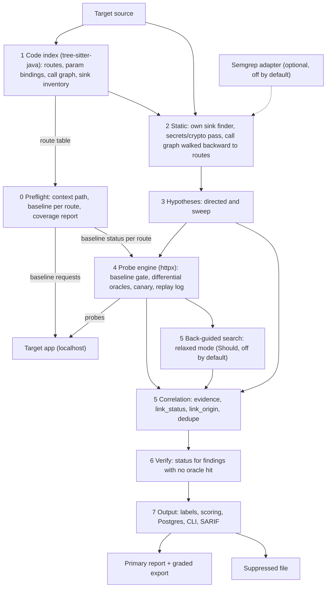
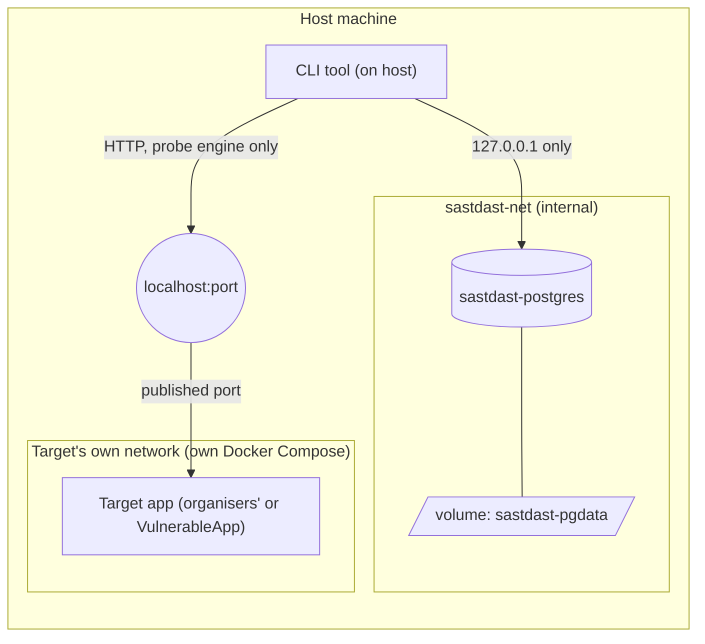

# Architecture

Status: target-state description. The stages below are a plan. Nothing here is claimed as built, tested or measured by this revision. How the code in the repo relates to this design: [implementation-plan.md](implementation-plan.md).

## Core idea

Static-guided dynamic testing. Static analysis produces hypotheses. Dynamic testing probes them.

A directed hypothesis keeps its `hypothesis_id` through the probe and into the evidence. A directed hit is linked by lineage, not by matching afterwards.

What this does and does not buy:

- A firing probe proves that route, param and CWE are exploitable.
- It does not prove which sink on that route is the cause.
- Wrong links therefore move from bad matching to same-route sink ambiguity. This design marks that ambiguity. It does not remove it.

## Run model (local mode)

- The target app runs from its own Docker Compose on our machine: the organisers' app at judging, OWASP VulnerableApp for practice.
- Our tool is a Python CLI. It reads the target's source folder and scans the target on `localhost`.
- DAST targets `localhost` only. Any other host is disqualification.
- One target framework per run.
- Our own stack (CLI + Postgres) runs separately from the target. See [Topology](#topology).

## Pipeline

Stage numbers are labels. The baseline step in stage 0 needs the route table from stage 1, so inside a scan the route table is built first `[proposed]`.

| Stage | Owner of the verdict | Output |
|---|---|---|
| 0 Preflight | Own code | Coverage report, baseline status per route |
| 1 Code index | Own code | Route table, param bindings, call graph, sink inventory |
| 2 Static | Own code | `(route, CWE, sink_id, call_path)` per finding, plus secrets and crypto findings |
| 3 Hypotheses | Own code | Directed and sweep hypotheses |
| 4 Probe engine | Own oracles | Probe records with `hypothesis_id` and `ORACLE` evidence |
| 5 Correlation | Own code, deterministic | Linked issues with `link_status`, `link_origin` and confidence |
| 6 Verify | Own code, deterministic | `status` for every finding with no oracle hit |
| 7 Output | Own code | Labels, scores, Postgres rows, report, SARIF |

### Stage 0: Preflight

| Item | Level | Notes |
|---|---|---|
| Read the context path | Must | `[TODO: confirm at kickoff: source of the value]` |
| One baseline request per mapped route | Must | Record 404, 401, 403, 400 and other statuses |
| Coverage report | Must | Routes mapped, reached, blocked |
| Source-revision check | Best-effort | Works only if the app exposes git info, e.g. `/actuator/info` |
| `/actuator/mappings`, `/v3/api-docs` route discovery | Best-effort | Often not exposed |
| Auth and CSRF detection | Best-effort | |

None of the best-effort items is part of the spine.

### Stage 1: Code index

Own code, tree-sitter-java.

- Route table: route template, method, handler file, function, line span.
- Param bindings: name, location, Java type.
- Call graph, with dependency-injection and interface-to-implementation cases resolved where simple.
- Sink inventory.
- Unresolved calls are flagged. They are never dropped.

### Stage 2: Static (Must)

- Own sink finder: tree-sitter plus a per-CWE YAML sink catalogue. It matches on call name and receiver type. No dataflow. Output: sink locations with `sink_id`.
- Own secrets and crypto pass: regex and entropy rules for hard-coded secrets (CWE-798), call-name rules for weak hashes and ciphers. Rules live in YAML.
- The call graph is walked backward from each sink to its entry routes. Output per finding: `(route, CWE, sink_id, call_path)`.

This gives route and call path. It does not say which param reaches the sink. The static stage never claims a param.

Semgrep is not part of the pipeline. It is an optional adapter, off by default, enabled by the config flag `semgrep.enabled`. Uses:

| Use | Purpose |
|---|---|
| Fallback sink source | For a non-Java target, until the own finder has an adapter |
| Cross-check | Sinks that both tools flag are marked corroborated |
| Benchmark yardstick | Run offline, outside the pipeline |

The pipeline and its tests must pass with Semgrep not installed.

Own flow engine: Should, built after M2. It narrows `candidate_params` from all to the specific param. It never blocks M1 or M2. Gate for making it the default: it matches Semgrep's 35 of 45 on VulnerableApp, with Semgrep run offline as the yardstick.

Receiver-type matching needs the type information in the code index. Calls whose receiver type does not resolve are flagged, not dropped `[TODO: define the fallback match]`.

### Stage 3: Hypotheses

| Kind | Content | Purpose |
|---|---|---|
| Directed | `(route, CWE, sink_id, call_path)` with `candidate_params` = all params of the route | The probe tries each param. The oracle shows which one fires. |
| Sweep | Every param by every supported class | Bugs static analysis missed |

### Stage 4: Probe engine

Own code, httpx.

| Part | Behaviour |
|---|---|
| Typed seeds | Valid values built from the index types. AI repair is Should. |
| Baseline gate | Attack a param only if its baseline returns the expected status. Otherwise record `blocked_by_validation`. That maps to `status: blocked` `[proposed]`. |
| Canary id | Unique id in every payload |
| Probe header | `X-Elenchus-Probe` on every request |
| Replay log | Full request and response for every probe |
| Header and cookie checks | Own code, about 30 lines. Covers the planted runtime-only class. Needs no correlation. |
| Session manager | Should |
| App-log tail | Could. Never in judging mode. |

Oracles are differential: each compares the probe response with the baseline.

| Class | Oracle |
|---|---|
| SQL injection | Error signature, boolean pair, or timing with repeats |
| XSS | Content type and reflection context: canary reflected unescaped in an HTML context |
| Command injection | Timing with repeats |
| Path traversal | File-content marker |
| Open redirect | `Location` header host |

ZAP is an optional corroborating passive pass for the runtime-only bucket. It never owns a verdict. It is off the critical path and off in judging mode.

### Stage 5: Correlation

Evidence types: `PATH`, `ORACLE`, `TRACE`, `FAMILY`. Definitions in [finding-schema.md](finding-schema.md#linking-and-ambiguity). `TRACE` exists only when the optional log tail runs. It is not available in judging mode.

After an oracle fires, hypotheses are grouped by `(route, param, CWE)`.

| Group size | `link_status` | Result |
|---|---|---|
| One | `unique` | Linked by lineage |
| More than one | `ambiguous` | Lower confidence. All candidate sinks attached as `alternatives`. One primary chosen. |

Two link fields. Both are required and orthogonal.

| Field | Values | Meaning |
|---|---|---|
| `link_status` | `unique`, `ambiguous` | How many candidate sinks the link has |
| `link_origin` | `directed`, `sweep`, `back_guided` | How the link was produced |

`link_origin` alone would hide ambiguity on sweep links. `sweep` means a sweep hit matched a static finding of the same CWE whose `entry_paths` include the hit route `[proposed meaning]`.

- Primary rule `[proposed: more specific catalogue match first, then shorter call path, then source order; Semgrep corroboration counts only if the adapter ran]`. A match on receiver type and call name is more specific than a match on call name alone `[proposed meaning]`.
- `TRACE` resolves ambiguity when present.
- Sweep hits (oracle fired, no directed hypothesis): matched to a static finding by route and CWE with `link_origin: sweep`, lower confidence. Otherwise see [Back-guided static search](#back-guided-static-search).
- Confidence is a deterministic function of the evidence present, `link_status` and `link_origin`. Reasons are stored. Weights live in config.
- `sink_id` for the Must set is `(file, enclosing_method, start_line, start_col)`. Refining it to `(method, call-site ordinal, arg index)` is Could.
- Dedupe key is `(sink_id, cwe)` `[proposed]`. The resolved param is an attribute. Several firing params on one sink are several evidence entries on one issue.
- One sink reached from several routes is one issue with several `entry_paths`. A config flag decides how the export counts it.

### Back-guided static search

Tier: Should. Owner: Person A. Config `backguided.enabled`, default false until measured.

Purpose: for a runtime-only hit (sweep, oracle fired, no hypothesis), try to attach a code location.

Strict mode (receiver type resolved, same catalogue) is already covered by the stage 2 directed hypotheses. It is not a separate pass. This pass exists for relaxed mode only.

Relaxed mode:

- Match the call name alone when the receiver type is unresolved.
- Walk through unresolved calls up to N hops `[proposed: N = 3]`. Record the count in `unresolved_hops`.
- Every match carries `match_mode: relaxed`.

Method: start at the hit route's handler, walk the call graph forward, look for sinks of the same CWE.

| Candidates of the same CWE reachable from the handler | Result |
|---|---|
| Exactly one | Attach as `PATH` evidence. `link_origin: back_guided`, `link_status: unique`, confidence low. Label Confirmed only if confidence is at or above config `backguided.min_confidence_to_confirm` `[TODO: set value]`. Below that, the label stays Runtime-only and the candidate stays attached `[proposed]`. |
| More than one | Label stays Runtime-only. `link_status: ambiguous`. Candidates go in `candidate_sinks` as hints. No Confirmed link is exported. |
| None | Stays Runtime-only. `unlinked_reason` set. |

Rules:

- Never runs for header, cookie or info-leak findings.
- A back-guided link never overrides a directed link on the same issue `[proposed]`.
- Producer entry: `run_back_guided(target, route_map, runtime_only_findings)`. Person A implements it, reading A's index and sink catalogue. The CLI calls it after the probe stage and passes the result to correlation `[proposed order]`. Person B consumes the resulting evidence through the cli seam.
- Measurement: run VulnerableApp with it on and off against `expected_pairs`. If it adds no correct links, or adds any wrong link, leave it off.

### Stage 6: Verify and negative evidence

Every static finding without an oracle hit gets exactly one status.

| `status` | Condition | Report |
|---|---|---|
| `tested_negative` | Baseline valid for every candidate param, every candidate param probed, all payload families for the CWE tried within budget | Suppressed (PRD bonus B-2) |
| `no_http_path` | No route reaches the sink | Primary report, Code-only, reason shown |
| `blocked` | Baseline gate failed | Primary report, Code-only |
| `untested` | Not reached | Primary report, Code-only |

- Secrets and crypto findings (CWE-798 and similar) are Code-only by nature. They are never labelled `no_http_path`.
- `no_http_path` for injection CWEs: suppress or keep `[TODO: decide]`. Flag `export.suppress_no_http_path`, default false.
- Tradeoff: suppression cuts false alarms. It lowers code-detection recall if the probe missed a real bug. `[TODO: choose the default by running VulnerableApp with and without suppression]`

### Conflict: positive oracle versus tested_negative

Case: an `ORACLE` hit matches the `(route, param, CWE)` of a sink marked `tested_negative`.

1. Replay the probe up to 3 times.
2. Fires in at least 2 of 3 replays: un-suppress the finding and clear `tested_negative`. Set `link_status: ambiguous` and `conflict: true`. Record the reason "directed probes negative, positive hit on replay". Lower the confidence. Move it to the primary report.
3. Does not reproduce: keep `tested_negative`. Set `oracle_flaky: true` on that evidence entry. Create no link. The hit stays Runtime-only.

Rationale: a positive oracle is stronger evidence than a failed probe. One unconfirmed hit is not enough to override an adequately tested negative.

### Stage 7: Output

- Labels: Confirmed, Code-only, Runtime-only.
- Scoring from config: CWE severity table, exploit factor, evidence-based link factor.
- Postgres, CLI report, SARIF at the boundary, VulnerableApp benchmark adapter.
- Measurement: a hand-made expected-pairs file for VulnerableApp. Each pair: route, param, CWE, sink file, sink line. `[proposed path: common/fixtures/expected_pairs/vulnerableapp.yaml]`. It measures correct-link and wrong-link rates, because the grader scores SAST and DAST separately. It is used for measurement only and never feeds scanner logic. Replace or extend it with the organisers' answer key at kickoff.

### Graded export and suppressed file

| Output | Contents |
|---|---|
| Primary report and graded export | Every finding except `suppressed`. |
| Suppressed file | `tested_negative` findings, each with its reason. |
| Postgres | Everything, including suppressed findings. |

Config flag `export.include_suppressed`, default false, merges the suppressed findings into the graded export.

## Judging mode

The organisers run the target at judging. A separate config profile applies.

| Rule | Value |
|---|---|
| Log tail | Off |
| Target restarts | None |
| Config | Zero. Detect base URL, context path and routes. `[TODO: how base URL is detected on localhost]` |
| Command | One |
| Time budget per stage | `[TODO: set values]` |
| AI | Off, or call-capped with a deterministic fallback |
| ZAP | Off |
| Semgrep | Off |
| `TRACE` evidence | Unavailable. Ambiguous links stay ambiguous. |
| Total runtime target | Under 5 minutes |

Everything is detected. Nothing is assumed.

## Milestones

Time is not a constraint. Work is ordered by dependency. Milestone gates replace hour gates. Details: [implementation-plan.md](implementation-plan.md#milestones).

| Milestone | Scope |
|---|---|
| M1 spine | One command on a clean VulnerableApp run yields at least one Confirmed error-based SQL injection issue whose sink file and line match `expected_pairs`. No other stage is added until M1 passes. |
| M2 core | All four classes, own header and cookie checks, the suppressed file, the judging-mode profile, the benchmark adapter, `expected_pairs` measurement. |
| M3 extras | The Should list. |

## AI advisor (optional side channel)

Use it only where the task is fuzzy, the output is machine-checkable and a wrong answer is caught. Hard rules: [AGENTS.md](../AGENTS.md).

| Task | Check on the output | Level |
|---|---|---|
| Propose source, sink and sanitiser specs for custom wrappers | Must name real symbols | `[TODO: tier]` |
| Generate seeds from DTOs | Baseline must pass. At most 3 repairs. | Should |
| Propose payload variants when blocked | Oracle decides. Strict budget. | Could |
| Judge `tested_negative` findings | Demote only, with a written reason | Should |
| Write fix text (B-4) | Advisory | `[TODO: tier]` |

The pipeline passes its tests with AI off. AI is measured by running VulnerableApp with and without it and reporting the recall and link difference.

## Residual flaws

| Flaw | Effect | Mitigation |
|---|---|---|
| Same-route sink ambiguity | `TRACE` is unavailable at judging, so some links stay ambiguous | Mark `ambiguous`, attach alternatives. Measure how often it happens on VulnerableApp. |
| A real third sink that was never found | The proof links to the wrong hypothesis with misleading confidence | Only `TRACE` catches this |
| Second-order bugs (stored XSS) | Need a write/read route-pair config, or stay unlinked | `injected_route` and `observed_route` fields. Route-pair config is Could. |
| IDOR and business logic | No oracle | None in this design |
| Blind SSRF and XXE | Need out-of-band callbacks. Localhost-only scanning limits this. | None in this design |
| Index gaps | Unresolved calls, Lombok or generated code, reflection | Flag unresolved calls. Never drop them. |
| Sink catalogue quality | Recall depends on the quality of the sink catalogue. Custom wrappers are missed unless the catalogue or an AI spec proposal covers them. | Extend the catalogue. AI spec proposals (Should or Could, `[TODO: tier]`). Measure on VulnerableApp. |
| Non-Java target | Stages 1 and 2 need a new adapter. The rest is unchanged. | Adapter boundary. The optional Semgrep adapter can supply sinks as a fallback. |

## Components

| Component | Framework-specific? | Role |
|---|---|---|
| Code index | Yes | Stage 1. tree-sitter-java. |
| Static stage | Yes | Stage 2. Own sink finder, own secrets and crypto pass, call-graph walk. |
| Semgrep adapter | Optional | Off by default (`semgrep.enabled`). Fallback sink source, cross-check, benchmark yardstick. |
| Preflight | No | Stage 0 |
| Hypothesis builder | No | Stage 3 |
| Probe engine | No | Stage 4. httpx. Oracles, canary, replay log. |
| Correlation + verify | No | Stages 5 and 6. Deterministic. |
| Output | No | Stage 7. Scoring, Postgres, CLI, SARIF, benchmark adapter. |
| AI advisor | No | Optional. Advisory only. |

| Adapter | Status | Route annotations | Param annotations |
|---|---|---|---|
| Java / Spring MVC | Primary | `@RestController` / `@Controller`, class `@RequestMapping`, method `@GetMapping` / `@PostMapping` / `@RequestMapping` | `@RequestParam`, `@PathVariable` |
| Java / JAX-RS | Secondary | Class + method `@Path`, `@GET` / `@POST` | `@QueryParam`, `@PathParam` |

The route table must handle dynamic segments (`/x/{id}` matched against `/x/5`) and class-level base paths. It must read annotation shapes, not names from the test app.

SARIF appears only at the edges: SARIF in from the optional Semgrep adapter, correlated SARIF out. Everything between uses the internal finding record ([finding-schema.md](finding-schema.md)).

## Topology

Our stack and the target app are separate. They share no Docker network and no volume. The only bridge is the scanner's HTTP calls to `localhost:<port>`.

| Item | Proposed name | Purpose |
|---|---|---|
| Network | `sastdast-net` | Our services only. The target never joins it. |
| Volume | `sastdast-pgdata` | Postgres data. Survives target teardown and reset. |
| Loopback bridge | `sastdast-hostport` | Enables the database's loopback-only host port. |
| Service | `postgres` | Official `postgres:17-alpine` image. |

The Compose file is [infra/compose.yaml](../infra/compose.yaml). Its database port is bound only to `127.0.0.1`.

What the store holds:

| Data | Used for |
|---|---|
| Scan runs (`run_id`) | Cross-run identity |
| Raw per-stage findings | Audit, re-correlation |
| Correlated issues, including suppressed | Report, FR-6 dedupe, B-5 comparison |
| Evidence and replay-log references | FR-8 issue detail |
| Benchmark results | Self-scoring history |

Rules:

- The probe engine reaches the target over the host at `localhost:<port>`. It never joins the target's network.
- Postgres is not reachable from the target. It is not exposed beyond our network.
- The store holds our tool's own state. It does not change the localhost-only rule or CLI-only delivery.
- The CLI runs on the host (D-14). If ZAP runs, it runs on the host or in host-network mode with its API on `127.0.0.1`. It never joins the target's Docker network.

Credentials handling for Postgres: `[TODO]`. Never commit them.

## End-to-end workflow

1. Start Postgres. `[TODO: exact command]`
2. Start the target app with its own Docker Compose on `localhost`.
3. Run the CLI with the source folder and the localhost URL. A new `run_id` is recorded. `[TODO: exact CLI]`
4. Build the code index.
5. Run preflight. Write the coverage report.
6. Run the static stage (own sink finder and secrets/crypto pass). Build hypotheses.
7. Probe. Write the replay log.
8. Correlate and verify.
9. Write Postgres rows, the primary report, the graded export and the suppressed file.

## Self-scoring harness (VulnerableApp)

- VulnerableApp ships a grader at `POST /VulnerableApp/scanner/benchmark`.
- It scores SAST and DAST findings separately against its answer key. It writes a coverage / missed / unmatched report.
- It does not grade correlation. The expected-pairs file in stage 7 measures link quality.
- Body shapes and vocabulary: [finding-schema.md](finding-schema.md).
- The grader takes its own JSON, not our SARIF export.
- Grader results are stored in our Postgres for comparison across runs.
- VulnerableApp has no hard-coded-secrets module. The crypto or JWT module stands in for the Code-only path.
