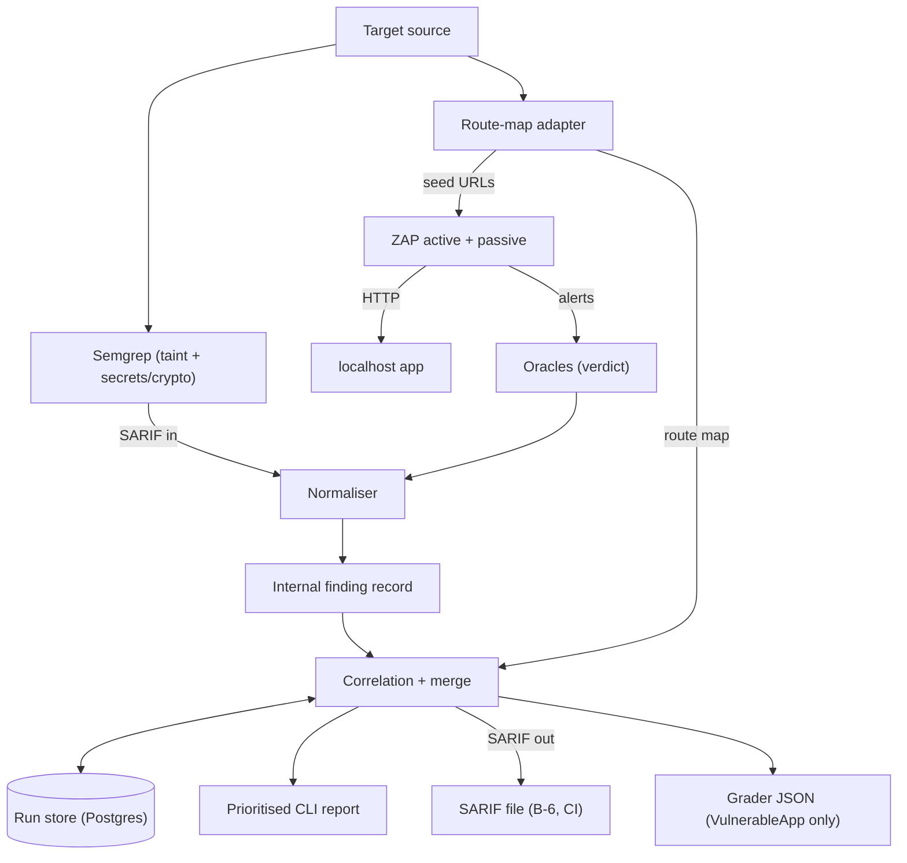
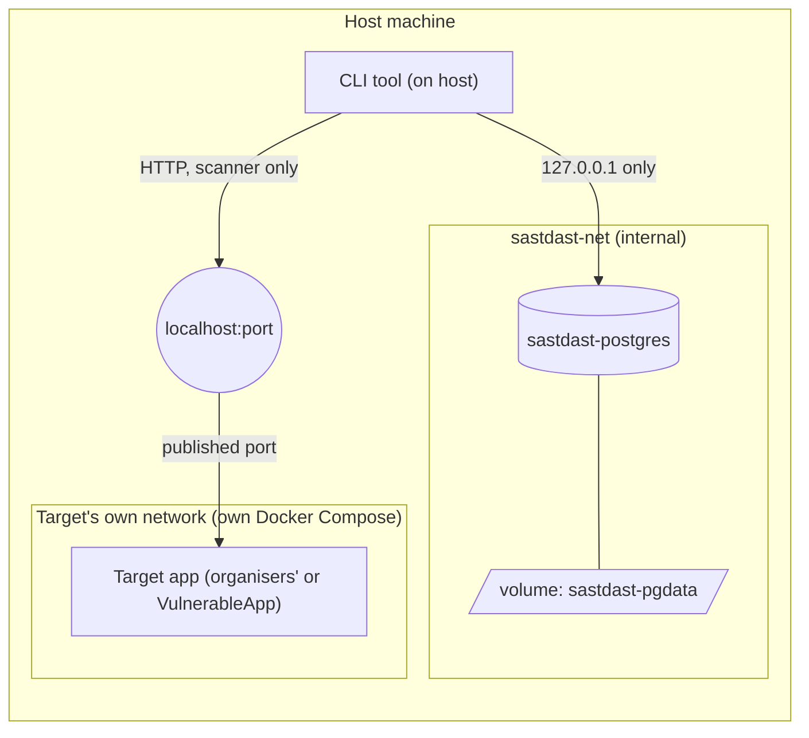

# Architecture

Status: Spring route-map and Semgrep SAST producers, the localhost-scoped ZAP producer, the consumer engine, and the host CLI scan command are implemented. The ZAP API and oracle paths have unit coverage; a full VulnerableApp DAST benchmark remains unverified because that target is not present in this checkout.

## Run model (local mode)

- The target app runs from its own Docker Compose on our machine: the organisers' app at judging, OWASP VulnerableApp for practice.
- Our tool is a Python CLI. It reads the target's source folder and scans the target on `localhost`.
- DAST targets `localhost` only. Any other host is disqualification.
- One target framework per run.
- Our own stack (CLI + Postgres) runs separately from the target. See [Infrastructure (our stack)](#infrastructure-our-stack).

## Components

| Component | Framework-specific? | Role |
|---|---|---|
| SAST adapter | Yes | Runs Semgrep taint and pattern rules for Spring MVC. SARIF findings are normalized into the shared record. |
| Route-map adapter | Yes | Parses Spring MVC source with tree-sitter-java into routes, handler spans, params, and bounded call edges. |
| DAST runner | No | Drives the ZAP API on localhost. Scans only route-map URLs inside an exact localhost context. |
| Oracles | No | Deterministic checks for SQL errors, raw XSS reflection, command output, external redirect headers, and missing response headers. |
| Normaliser | No | Maps Semgrep SARIF and ZAP alerts to the internal finding record, with grader vocabulary. |
| Correlation + merge | No | Tiered linking, labels, dedupe across runs, risk score. |
| Run store | No | Our Postgres. Runs, raw findings, issues, evidence, benchmark results. Backs FR-6 dedupe and B-5 comparison. |
| Report | No | Prioritised CLI report. SARIF export and CI exit code (B-6). |
| Grader client | No | Sends findings to the VulnerableApp grader in its own JSON. Practice only. |
| AI helpers | No | Advisory only: fix text, link explanations, false-positive demotion. |

Producer entries (frozen in `common/`, see [finding-schema.md](finding-schema.md)):

```
route_map(target) -> RouteMap
run_sast(target, route_map) -> [Record]
run_dast(target, route_map) -> [Record]
```

The SAST and route-map entries are framework-specific. The DAST entry is not. The route-map parser also records one-hop call edges from each handler.

| Adapter | Status | Route annotations | Param annotations |
|---|---|---|---|
| Java / Spring MVC | Primary | `@RestController` / `@Controller`, class `@RequestMapping`, method `@GetMapping` / `@PostMapping` / `@RequestMapping` | `@RequestParam`, `@PathVariable` |
| Java / JAX-RS | Secondary | Class + method `@Path`, `@GET` / `@POST` | `@QueryParam`, `@PathParam` |

Parser: tree-sitter-java.

The route map must handle dynamic segments (`/x/{id}` matched against `/x/5`) and class-level base paths. It must read annotation shapes, not names from the test app.

## Data flow

SARIF appears only at the edges. Everything between them uses the internal finding record ([finding-schema.md](finding-schema.md)).



The Semgrep taint and pattern rules both emit SARIF, which the SAST runner maps to the shared record.

## Correlation design

Output is a confidence tier, not a boolean. CWE must match in every tier. Param match is the main guard for the <5% wrong-link target.

| Tier | Rule | Confidence | Notes |
|---|---|---|---|
| A | SAST sink line inside the DAST route's handler span, same param | Highest | Rare on Spring: the sink usually sits in a service class. |
| B | DAST route + method appears in the SAST record's `reached_via` (one-hop call edge from a handler to the method holding the sink), same param | High | **Main path on Spring.** Controller → service layering puts the sink in another file. |
| C | Route + param match only, no line link | Low | Linked but flagged. |

- No SAST partner: Runtime-only.
- No DAST partner: Code-only.
- Dedupe key: `dedupe_key()` in `common/`. `(cwe, file, line)` when present, else `(cwe, route, method, param)`. App-wide header findings collapse to `(cwe, header_name)`.
- Merge rule: a newly linked pair searches stored issues by both keys and merges into any match, including a stored Runtime-only issue.
- Sort: Confirmed first, then `risk_score` = f(severity, exploit ease, confidence).

Tier B uses call edges from the route-map parser, not a cross-file taint trace. Semgrep OSS 1.183 SARIF emits no `codeFlows` for the taint rules covered by our tests. See [decisions.md](decisions.md) D-07.

Call-edge limits to check against the real app `[TODO: confirm at kickoff]`:

- One cross-class hop only. Same-class helper calls are followed transitively. A sink in a repository called by the service is two cross-class hops away.
- The parser resolves service interfaces to implementations.
- Parameter names are not data-flow mapped across calls. A SAST sink whose local variable name differs from the route parameter may not satisfy the Tier B parameter guard.

## Oracles

| Type | Oracle |
|---|---|
| SQLi | A database error signature in the captured ZAP response body. Time-only alerts are not confirmed. |
| XSS | The ZAP attack string appears unescaped in the captured response body. |
| Command injection | A recognized command-output marker is reflected in the response. Time-only alerts are not confirmed. |
| Open redirect | A redirect response contains an absolute `Location` outside localhost. The redirect is not followed. |
| Missing security header | The named header is absent from the captured response headers. |

Each oracle checks the response captured for the ZAP alert. Alerts without matching deterministic evidence are discarded. The command-injection oracle does not confirm time-delay-only findings.

## Infrastructure (our stack)

Our stack and the target app are separate. They share no Docker network and no volume. The only bridge is the scanner's HTTP calls to `localhost:<port>`.



| Item | Proposed name | Purpose |
|---|---|---|
| Network | `sastdast-net` | Our services only. The target never joins it. |
| Volume | `sastdast-pgdata` | Postgres data. Survives target teardown and reset. |
| Loopback bridge | `sastdast-hostport` | Enables the database's loopback-only host port. |
| Service | `postgres` | Official `postgres:17-alpine` image. |

The Compose file is [infra/compose.yaml](../infra/compose.yaml). Its database port is bound only to `127.0.0.1`.

What the store holds:

| Data | Used for |
|---|---|
| Scan runs (`run_id`) | Cross-run identity |
| Raw per-scanner findings | Audit, re-correlation |
| Correlated issues | Report, FR-6 dedupe |
| Evidence | FR-8 issue detail |
| Benchmark results | Self-scoring history |

Rules:

- Our scanner reaches the target over the host at `localhost:<port>`. It never joins the target's network.
- Postgres is not reachable from the target. It is not exposed beyond our network.
- The store holds our tool's own state. It does not change the localhost-only rule or CLI-only delivery.

Placement (D-14): the DAST-capable CLI runs on the host. Postgres publishes its port on `127.0.0.1` only, through a second bridge network `sastdast-hostport`, because Docker does not publish ports from internal-only networks. Run ZAP on the host or in host-network mode, with its API bound to `127.0.0.1`; do not connect ZAP to the target's Docker network.

Credentials handling for Postgres: `[TODO]`. Never commit them.

## End-to-end workflow

1. Start Postgres with `docker compose -f infra/compose.yaml up -d postgres`.
2. Start the target app with its own Docker Compose on `localhost`.
3. Start ZAP's API on host loopback and set `ZAP_API_KEY`; configure PostgreSQL credentials if persistence is enabled.
4. Run `elenchus scan --source-path <source> --base-url http://127.0.0.1:<port>/<context>`. A new `run_id` is recorded.
5. The route-map adapter builds the map. Semgrep runs against source; ZAP scans only its mapped routes.
6. Oracles verify response evidence. Unverified alerts are discarded.
7. Correlation links, labels, merges against stored issues, and scores.
8. The CLI prints the prioritized list and can export SARIF.

## Self-scoring harness (VulnerableApp)

- VulnerableApp ships a grader at `POST /VulnerableApp/scanner/benchmark`.
- It scores SAST and DAST findings separately against its answer key. It writes a coverage / missed / unmatched report.
- It does not grade correlation. We measure link quality ourselves.
- Body shapes and vocabulary: [finding-schema.md](finding-schema.md).
- The grader takes its own JSON, not our SARIF export.
- Grader results are stored in our Postgres for comparison across runs.
- VulnerableApp has no hard-coded-secrets module. The crypto or JWT module stands in for the Code-only path.
