# Implementation plan

Status: plan for the target architecture in [architecture.md](architecture.md). This revision does not claim that anything is built, tested or measured. No benchmark results are recorded here.

Time is not a constraint. Work is ordered by dependency. The plan is split into **build stages**, not between people. Anyone can pick up the current build stage.

Two sets of numbers, kept apart:

| Term | Meaning |
|---|---|
| Pipeline stage, 0 to 7 | What the tool does at run time. See [architecture.md](architecture.md#pipeline). |
| Build stage, `BS0` onward | The order we build it in. Defined below. |
| Milestone, M1 to M3 | A gate over a group of build stages |

## Build stages

Rules:

- Build in order. Do not start a build stage until the one before has passed.
- A build stage passes only when its exit test has been run and the output recorded in [STATE.md](STATE.md).
- One short-lived branch per build stage, or several for a large one.
- Commit after each build stage passes its exit test.
- A build stage that needs a contract change flags it as one and updates [finding-schema.md](finding-schema.md) first.

| Build stage | Goal | Pipeline stages | Depends on | Milestone |
|---|---|---|---|---|
| `BS0` | ZAP acceptance check | 4 | Nothing | M1 |
| `BS1` | Contract, config, fixtures | All | `BS0` | M1 |
| `BS2` | Code index | 1 | `BS1` | M1 |
| `BS3` | SQL sinks and hypotheses | 2, 3 | `BS2` | M1 |
| `BS4` | Preflight and probe spine | 0, 4 | `BS1`, `BS3` | M1 |
| `BS5` | End-to-end spine | 5, 7 | `BS4` | M1 gate |
| `BS6` | All classes and the scheduler | 2, 3, 4 | `BS5` | M2 |
| `BS7` | Negative evidence, ambiguity, coverage | 5, 6, 7 | `BS6` | M2 |
| `BS8` | Secrets, exports, measurement | 2, 7 | `BS7` | M2 |
| `BS9` | Judging mode and generality | All | `BS8` | M2 gate |
| `BS10` | Should list | Various | `BS9` | M3 |
| `BS11` | Could list | Various | `BS10` | None |

```mermaid
flowchart LR
    bs0["BS0 ZAP check"] --> bs1["BS1 Contract"]
    bs1 --> bs2["BS2 Code index"]
    bs2 --> bs3["BS3 SQL sinks, hypotheses"]
    bs3 --> bs4["BS4 Preflight, probe spine"]
    bs4 --> bs5["BS5 Spine: M1"]
    bs5 --> bs6["BS6 All classes, scheduler"]
    bs6 --> bs7["BS7 Negatives, ambiguity, coverage"]
    bs7 --> bs8["BS8 Secrets, exports, measurement"]
    bs8 --> bs9["BS9 Judging, generality: M2"]
    bs9 --> bs10["BS10 Should: M3"]
    bs10 --> bs11["BS11 Could"]
```

### `BS0`: ZAP acceptance check

Why first: the job size in the contract, and the whole attribution design, depend on what ZAP actually does.

| Item | Detail |
|---|---|
| Build | A throwaway script, not pipeline code. Pin the ZAP image and version. Start VulnerableApp from its own Compose. |
| Check | The eight rows in [ZAP acceptance check](architecture.md#zap-acceptance-check) |
| Decide | Job size: `(route, method)`, or a fallback. Replacer or HTTP Sender for the probe header. |
| Set | `zap.version`, `zap.rule_map.<cwe>`, `zap.thread_per_host`, `probe.max_job_seconds`, first budget values |
| Exit test | All eight rows have a recorded result and a recorded decision. A failed row with its fallback chosen still passes. |

Passed on 2026-10-31. Results and decisions: [ZAP acceptance check](architecture.md#zap-acceptance-check).

### `BS1`: Contract, config, fixtures

| Item | Detail |
|---|---|
| Build | Update `common/record.py` to [finding-schema.md](finding-schema.md). Add `Hypothesis`, `ProbeJob`, `CodeIndex`. New fallback dedupe keys. A config loader that reads the [Config reference](architecture.md#config-reference) keys. |
| Update | Mechanical changes to the old engine, runner and tests, so they still run on the new record. Their logic is reworked in later build stages. |
| Fixtures | Replace the five old fixtures with [Required fixtures](#required-fixtures) rows 1 to 7 |
| Dependencies | Make Semgrep an optional extra. Its tests skip when it is not installed. |
| Docker | `cli/Dockerfile` installs from `uv.lock`, in two stages, with base images pinned by digest. `.dockerignore` keeps local state and secrets out of the build. |
| Exit test | `pytest` passes with Semgrep uninstalled. Every fixture loads through the new record. |

Fixture files hold `description`, `findings` (stage 2 and stage 4 records) and `expected` (the correlated result). The `expected` values are checked for valid contract values now, and against real correlation from `BS5` and `BS7` on.

### `BS2`: Code index

| Item | Detail |
|---|---|
| Build | Extend `producers/sast/spring_routes.py`: param Java types, `params_status`, DTO fields, `@RequestHeader`, `@CookieValue`, inherited mappings, `route_origin`. A multi-hop call graph with unresolved calls flagged. The current parser walks one hop. |
| Hand-made | `expected_pairs` for SQL injection on VulnerableApp |
| Exit test | Unit tests on small Java fixtures for each binding and call shape. A run on VulnerableApp's source with route, param and unresolved-call counts recorded. |

Passed on 2026-10-31. Counts are in [STATE.md](STATE.md).

### `BS3`: SQL sinks and hypotheses

| Item | Detail |
|---|---|
| Build | The catalogue YAML format with `kind` and source API. SQL entries. `arg_shape`. The backward walk to routes. `producers/hypotheses/`: directed and sweep hypotheses. |
| Line rule | A finding's `line` is the line of the dangerous argument, not the start of the call. VulnerableApp's answer key does this on multi-line calls, and its grader matches exact lines. `sink_id` keeps the call site. Confirm against the organisers' answer key at kickoff. |
| Exit test | On Java fixtures: a parameterised query is `constant`, a concatenated query is `dynamic`, an unreadable argument is `dynamic`. On VulnerableApp's source: SQL recall recorded with misses tagged, and the `expected_pairs` SQL sinks have a directed hypothesis. |

Passed on 2026-10-31. Results are in [STATE.md](STATE.md).

### `BS4`: Preflight and probe spine

| Item | Detail |
|---|---|
| Build | `probe/`: loopback check, context path detection, baselines, typed seeds. The ZAP client in `producers/dast/`. One-at-a-time jobs from `ProbeJob`, exact-route scope, allow-list policy, probe header. Request attribution. Error-based SQL injection oracle. Verification replay. Replay log. Run-end host check. |
| Exit test | Unit tests with recorded ZAP messages: zero-param and two-param diffs stay unlinked, a message without the header is dropped, a non-reproducing hit creates no record. A live run on VulnerableApp with `attribution_rate` and `header_propagation_rate` recorded, and only loopback in ZAP history. |

### `BS5`: End-to-end spine (M1 gate)

| Item | Detail |
|---|---|
| Build | Rework correlation to lineage, `link_status`, `link_origin`, config-driven confidence and `confidence_reasons`. Labels and scoring. Postgres. CLI report. One command. |
| Exit test | **M1:** one command on a clean VulnerableApp run uses ZAP active scanning and yields at least one Confirmed error-based SQL injection issue whose sink file and line match `expected_pairs`. `attribution_accuracy` recorded. |

If M1 cannot pass: cut to open redirect and error-based SQL injection, then fix the spine first.

### `BS6`: All classes and the scheduler

| Item | Detail |
|---|---|
| Build | Catalogue entries for XSS, command injection and open redirect, including `return_value`, `annotation`, `template` and `xml` kinds. Their oracles: XSS payload canary, command output then timing, `Location` host, boolean and timing SQL. The two-pass deadline scheduler. Sweep with type pruning. Own header and cookie checks. `target.auth.*`. |
| Decide | Probing a route with `params_status: unknown` whose handler reads every param. `XSSWithHtmlTagInjection` iterates its query map, so the index has no param name to seed. A generated name may work. |
| Decide | The XSS oracle on non-HTML responses. VulnerableApp's XSS routes reply `text/plain` while its page inserts the text as HTML. Recorded as an open question in [STATE.md](STATE.md). |
| Exit test | Each oracle passes unit tests on recorded vulnerable and safe responses. A live run on VulnerableApp finishes inside the budget, with wall time per stage, jobs run and jobs skipped recorded, and budget values updated. |

### `BS7`: Negative evidence, ambiguity, coverage

| Item | Detail |
|---|---|
| Build | Stage 6 status order, `safe_pattern`, the adequacy test, the suppressed file. The conflict rule. Ambiguity groups, the primary rule, `RESPONSE_TRACE` and the frame parser. The coverage report. |
| Fixtures | Rows 8 and 9 below, and the [decoy test plan](#decoy-test-plan) |
| Exit test | Every decoy and twin gets its required status. The suppressed file has real content. A live VulnerableApp run records `wrong_suppression_count` per CWE, with `export.suppress_cwes` updated, and the ambiguity rate. |

### `BS8`: Secrets, exports, measurement

| Item | Detail |
|---|---|
| Build | Own secrets and crypto pass, with its own static fixtures. SARIF export. Benchmark adapter. Measurement output for every row in [Measurement](architecture.md#measurement). |
| Measure | `export.include_alternatives` and `export.suppress_no_http_path`, each on and off. Keep the setting that meets the Great targets on both code detection and false alarms. If both do, keep the lower false-alarm rate. If neither does, keep the one with code detection above the Good target and the lower false-alarm rate. |
| Exit test | A full measurement table recorded in [STATE.md](STATE.md), with supported and raw scores side by side, per-CWE recall and tagged misses. No target has to be met to pass this build stage: the numbers are the baseline. |

### `BS9`: Judging mode and generality (M2 gate)

| Item | Detail |
|---|---|
| Build | `judging.profile`. The state guard. The generality CI tests. The catalogue freeze. |
| Exit test | **M2:** a judging-profile rehearsal on VulnerableApp with only `--target` and the source path, one command, no restarts, AI and Semgrep off, ZAP on, under 5 minutes. Drift handling tested with a forced drift. Generality CI passing. A static-only hold-out run recorded. |

### `BS10`: Should list (M3)

Build in the table's order. Each item has its own measurement rule where one is stated.

| Order | Item | Pipeline stage | Exit test |
|---|---|---|---|
| 1 | Path traversal class (CWE-22): catalogue entries, hypotheses, file-content oracle | 2 to 4 | Recall recorded for CWE-22 |
| 2 | Back-guided static search, relaxed mode only. Producer entry `run_back_guided(target, route_map, runtime_only_findings)`. Config `backguided.enabled`, off until measured. | 5 | On and off against `expected_pairs`. If it adds no correct links, or adds any wrong link, it stays off. |
| 3 | Own flow engine (narrows `candidate_params`). Gate for making it the default: matches the measured Semgrep count on VulnerableApp, Semgrep run offline as the yardstick. `[TODO: Semgrep count on VulnerableApp with unfitted rules; record count, date and rule version in STATE.md]` The earlier figure came from rules partly fitted to VulnerableApp and overstates generality. | 2 | The gate |
| 4 | Scan comparison (B-5): new, fixed and still-open issues, from stored runs and the dedupe key | 7 | Two stored runs compared |
| 5 | Session manager. Moves to `BS6` if kickoff shows the app needs a login. | 4 | Auth-gated routes reached on a fixture run |
| 6 | Supplemental ZAP passive alert ingestion (not a verdict owner) | 4 | Alerts stored, verdicts unchanged |
| 7 | Best-effort preflight items | 0 | Runs when exposed, skipped cleanly when not |
| 8 | AI with/without measurement harness. Built before any AI task. | All | Harness runs with AI off |
| 9 | AI fix text and link explanations (B-3, B-4). Advisory. Zero metric risk. | 7 | With/without run |
| 10 | AI seeds from DTOs, with repair. Only after non-AI typed seeds work. | 4 | With/without run |

### `BS11`: Could list

| Item | Pipeline stage |
|---|---|
| Semgrep optional adapter (fallback and cross-check) | 2 |
| App-log tail (`TRACE`). Never in judging mode. | 4 |
| AI payload variants when blocked | 4 |
| AI source, sink and sanitiser spec proposals | 2 |
| AI judging of `tested_negative` findings (demote only). The adequacy rule already demotes. | 6 |
| Chromium-confirmed XSS | 4 |
| Patch re-verification | 4 |
| Second-order read-back: after write jobs, re-read GET routes for a stored canary, using `injected_route` and `observed_route` | 4 |
| Refined `sink_id` | 2 |
| JAX-RS adapter. Promote to Should only if kickoff shows the graded app is not Spring. It would also earn PRD bonus B-7. | 1, 2 |

The Semgrep yardstick is separate from the adapter. Run it offline once before `BS10` item 3 needs it: use the public OWASP rule pack as shipped, make no edits after seeing results, and record the count, date and rule pack version.

## Existing code and the target

The repo predates this architecture. The table lists what exists in the tree, how it relates to the target, and which build stage reworks it. Whether each piece passes its tests today is not re-checked by this revision.

| Piece | In the tree | Relation to the target | Build stage |
|---|---|---|---|
| `producers/sast/spring_routes.py`, `call_graph.py`, `code_index.py` | Stage 1: route table, param bindings, multi-hop call graph with unresolved calls flagged | The sink inventory is added in `BS3`. | `BS2` |
| `producers/sast/semgrep_runner.py`, `rules/` | Semgrep runner, Semgrep-format taint and pattern rules, tests | Becomes the optional Semgrep adapter (`semgrep.enabled`, off by default). It must not guess `param`. Its tests must skip when Semgrep is not installed. The rules are Semgrep syntax and do not carry over to the own sink catalogue or secrets pass `[TODO: confirm]`. | `BS1`, `BS11` |
| `pyproject.toml` | Semgrep is an optional extra, `uv sync --extra semgrep` | The pipeline and its tests pass without it. | `BS1` |
| `producers/benchmark.py` | Offline SAST score against VulnerableApp's expected-issues CSV | Part of the benchmark adapter. Results not recorded here. Its CWE total currently covers only CWEs we report, so the raw score must be added. | `BS8` |
| `producers/dast/zap_runner.py` | ZAP-driven active DAST with response-oracle checks and tests. One scan per seed, then alerts read for the whole base URL. | Seed for the required ZAP active probe engine. Keep the API client. Replace alert-driven attribution with request attribution, the whole-base-path scope with exact routes, and fixed seeds with typed seeds. | `BS4`, `BS6` |
| `engine/correlate/` | Tier A/B/C correlation with tests | Rework: hypothesis lineage, `link_status`, `link_origin`, ambiguity groups, the conflict rule, evidence-based confidence. | `BS5`, `BS7` |
| `engine/store/`, `engine/report/` | Postgres store, text report, SARIF export | Reusable as the base for stage 7. Needs the new fields, the suppressed file and the coverage report `[TODO: verify]`. | `BS5`, `BS7`, `BS8` |
| `cli/main.py` | `correlate` and `scan` commands | Rework the scan flow to stages 0 to 7. | `BS5` |
| `common/record.py`, `common/pipeline.py`, `common/config.py` | The contract | Implements [finding-schema.md](finding-schema.md). | `BS1` |
| `common/fixtures/` | Fixture rows 1 to 7 in the new shape | Rows 8 onward follow in their build stages. | `BS1` |

## Required fixtures

Each at route granularity, with `candidate_params`.

| # | Fixture | Purpose | Build stage |
|---|---|---|---|
| 1 | Unique directed hit | Basic lineage link | `BS1` |
| 2 | Ambiguous group: two same-CWE sinks on one route | `link_status: ambiguous`, alternatives, primary rule | `BS1` |
| 3 | `tested_negative` decoy | Suppression and the suppressed file | `BS1` |
| 4 | Blocked baseline | `status: blocked` | `BS1` |
| 5 | `no_http_path` | Code-only with a reason | `BS1` |
| 6 | Runtime-only header | Own header check, no correlation | `BS1` |
| 7 | Sweep hit, two variants: matched to a static finding by route and CWE, and no match | `link_origin: sweep`, lower confidence. Stays Runtime-only when there is no match. | `BS1` |
| 8 | Conflict: oracle hit on a `tested_negative` sink, two variants, and on a `constant` `safe_pattern` sink | Reproduces: `conflict: true`, un-suppressed. Does not reproduce: `oracle_flaky: true`, no link. Constant sink: stays `safe_pattern`, hit stays Runtime-only. | `BS7` |
| 9 | `RESPONSE_TRACE`, three variants: frame in one candidate, frame in no known sink, no frame | Upgrade to `unique`, catalogue gap, no change | `BS7` |
| 10 | Back-guided link, one candidate `[proposed]` | `link_origin: back_guided`, `match_mode: relaxed`, `unresolved_hops` | `BS10` |
| 11 | Back-guided search, several candidates `[proposed]` | `link_status: ambiguous`, `candidate_sinks`, label stays Runtime-only | `BS10` |

## Decoy test plan

A sink finder with no dataflow flags safe code unless something clears it. Each decoy has a vulnerable twin, so a rule that clears too much also fails a test.

Three layers, so no extra live target is needed:

| Layer | Form | Runs in |
|---|---|---|
| Static | Small Java source files | CI. `arg_shape` and hypothesis checks. |
| Oracle | Recorded response pairs, safe and vulnerable | CI. Oracle and adequacy checks. |
| Live | VulnerableApp's `SECURE` variants. `/scanner` lists 24 of its 171 routes as `SECURE`, including SQL injection, XSS and open redirect levels. | `BS7` run, compared with `expected_pairs` |

| Decoy | Required status | Vulnerable twin | Required result |
|---|---|---|---|
| Parameterised SQL with a literal | `safe_pattern` | Same query built by concatenation | Confirmed |
| Parameterised SQL, literal in a local variable assigned once | `safe_pattern` | Variable reassigned from input | Confirmed |
| Directly escaped HTML output | `safe_pattern` | Same output unescaped | Confirmed |
| Allowlisted redirect target | `tested_negative` | No allowlist | Confirmed |
| Allowlisted `ORDER BY` column, concatenated | `tested_negative` | Column not checked | Confirmed |
| Numeric param concatenated into SQL, rejected by binding | `tested_negative`, outcome `type_rejected` | Same code with a string param | Confirmed |
| Safe sink with no route | `safe_pattern` | Unsafe sink with no route | `no_http_path` |

Any decoy reported as an issue, or any twin suppressed, fails the build stage. Reporting one safe decoy counts as a false alarm in the PRD.

## PRD bonus items

| Bonus | Where it lands |
|---|---|
| B-1 Auto-verify Code-only | Directed probes (`BS4`, `BS6`) |
| B-2 Cut SAST noise | `safe_pattern` and `tested_negative` suppression (`BS7`) |
| B-3 Explain links | Confidence reasons stored (`BS5`). AI link explanations (`BS10`). Report display `[TODO]`. |
| B-4 Fix suggestion | AI fix text (`BS10`) |
| B-5 Compare two scans | `BS10` |
| B-6 SARIF and CI exit | `BS8` |
| B-7 Second framework | JAX-RS (`BS11`). Promote only if kickoff shows the graded app is not Spring. |

## Cut order

If scope must shrink, drop in this order. `BS0` to `BS9` are never cut as stages, but the scheduler may cut sweep work at run time.

1. Could items, last row first
2. Own flow engine
3. Back-guided search
4. B-5 scan comparison
5. Supplemental ZAP passive alert ingestion
6. AI items
7. Session manager (unless kickoff shows a login)
8. Best-effort preflight items
9. Path traversal (cut last among the Should items, because it covers a PRD type)

Never cut: the contract, the code index, the own sink finder, hypothesis linking with ambiguity marking, ZAP active scanning with its baseline gate and deterministic oracles, the run store, the CLI report, the judging profile.

The pipeline and its tests must pass with Semgrep not installed. Semgrep stays an optional adapter, off by default. ZAP is required for active runtime probing, including judging mode; the judging profile must enforce bounded ZAP use, not disable it.

## Metric targets

From the PRD. These are targets. No results are recorded, and nothing here claims they will be met. The first real numbers come from `BS8`. Definitions of what else we measure: [Measurement](architecture.md#measurement).

| What we measure | Good | Great |
|---|---|---|
| Code detection | >60% | >85% |
| Runtime detection | >50% | >80% |
| Correct links (of 20 pairs) | >50% | >80% |
| Wrong links | <20% | <5% |
| False alarms | <30% | <10% |
| Unseen app (pairs linked) | >40% | >65% |
| Run time | <15 min | <5 min |

VulnerableApp's grader measures detection only. Semgrep is run offline as a yardstick, outside the pipeline. Link metrics are measured against the `expected_pairs` file. A VulnerableApp score does not show the unseen-app target. See [Generality](architecture.md#generality).

## Docs rule

Only these files are kept current while coding: `AGENTS.md`, `docs/architecture.md`, `docs/finding-schema.md`, `docs/implementation-plan.md` and `docs/STATE.md`. ADRs and README polish wait until the code runs. The stale files are listed in [STATE.md](STATE.md).
