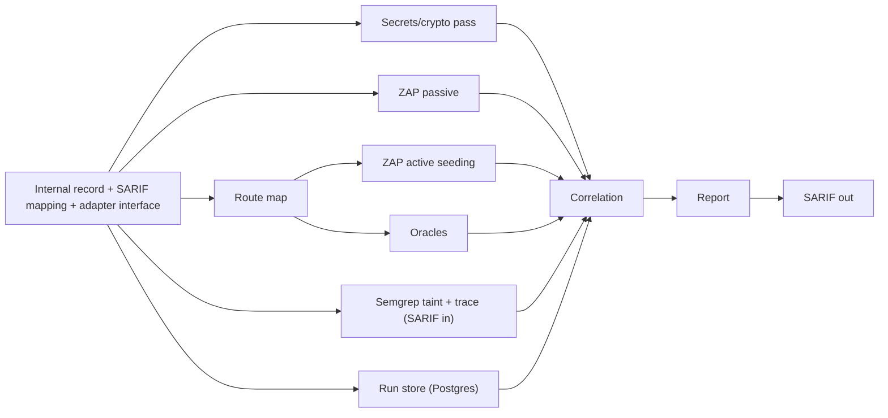

# Implementation plan

Status: plan with the initial Person B consumer path implemented. Producers and end-to-end scanning are not built; no benchmark metrics have been measured. Hackathon length and team size: `[TODO: confirm at kickoff]`

## Person B implementation status

| Area | Status |
|---|---|
| Finding consumer and correlation | Implemented against the documented record fields. Tiers A/B/C, deterministic ambiguity handling, labels, deduplication, and provisional risk ranking have unit coverage. |
| Persistence | PostgreSQL run/finding/issue tables and code/route aliases implemented. Cross-run Runtime-only + Code-only merge was exercised against the local Compose database. |
| CLI and report | JSON record input, prioritized text/JSON output, SARIF 2.1.0 export, and CI exit behavior implemented. The Spring route-map parser exists, but producer orchestration and canonical `common/` types are still pending, so the CLI accepts records rather than invoking producer entry points. |
| Containers | CLI image and official `postgres:17-alpine` service defined in [infra/compose.yaml](../infra/compose.yaml). Database is on a private network with a named volume and no published port. |
| Pending | Align with the future canonical code in `common/`, connect Person A's producer functions at the CLI seam, confirm risk-score and CI severity policy, and run against the target app. `common/` was not changed. |

## Phases

| Phase | Work | Unblocks |
|---|---|---|
| 0. Pre-kickoff | Run VulnerableApp on localhost. Read its `benchmarks/README.md`. Fill the vocabulary table in [finding-schema.md](finding-schema.md). Self-benchmark SAST and DAST separately against `POST /VulnerableApp/scanner/benchmark`. | Vocabulary, early recall numbers |
| 1. Hour one | Ratify and freeze the internal finding record and its SARIF mapping. Fix the adapter interface. Ratify network, volume and service names. | Everything |
| 1b. Our infra | Run the containerized CLI and official PostgreSQL image on `sastdast-net` with volume `sastdast-pgdata`. Keep the target app on its own network. | Run store for phase 5 dedupe |
| 2. Easy points | Secrets/crypto pass (Code-only). ZAP passive scan (Runtime-only headers). | 16 of 36 bugs, no correlation needed |
| 3. Spring MVC adapter | Route map: annotations, base paths, dynamic segments, params. Semgrep taint rules with full `taint_trace`. Semgrep SARIF ingest. | Correlation, ZAP seeding |
| 4. DAST + oracles | ZAP active scan seeded from the route map. Oracles for the four types. | Confirmed labels |
| 5. Correlation | Tiers A, B, C. Labels. Merge by the code and route aliases in D-17. Provisional risk score. | Report, link metrics |
| 6. Report | Prioritised CLI output with FR-8 issue detail. README run steps. | Demo |
| 7. Harden + measure | Run on the organisers' app. Measure links against the 20 pairs. Fix wrong links. | Scoring |
| 8. Secondary + bonus | JAX-RS adapter. AI helpers B-4, B-3. Then B-2 and B-5 (scan comparison from the run store). B-6 SARIF export and CI exit behavior are implemented. | Bonus points |

D-07 is resolved: Tier B uses call edges (`reached_via`). Phase 3's route-map parser must emit one-hop call edges. See [decisions.md](decisions.md).

## Dependency order

## Parallel tracks (small team)

| Track | Owns | Starts after |
|---|---|---|
| SAST | Semgrep taint rules, trace output, secrets/crypto pass | Schema frozen |
| Route map | Spring MVC parser, then JAX-RS | Schema frozen |
| DAST | ZAP driver, seeding, oracles | Schema frozen. Seeding waits on route map. |
| Correlation | Tiers, merge, scoring, report, link measurement | Schema frozen. Works on hand-written fixtures until real findings exist. |
| Infra | Postgres network, volume and service; run store; SARIF export | Names ratified. Store must exist before phase 5 merge. |

Owners: `[TODO: team names]`

## Cut list (drop in this order if short on time)

1. Fuzzy correlation fallback and taint-spec inference
2. B-1 auto-verify
3. JAX-RS adapter
4. Nuclei
5. B-5 scan comparison
6. Path traversal (CWE-22)
7. B-2 false-positive triage

B-6 SARIF export and CI exit behavior are implemented and are no longer in the cut list.

Never cut: internal record, Semgrep SARIF ingest, run store (FR-6 re-run dedupe), Spring adapter, Tier B, param guard, oracles, CLI report.

## Metric targets

From the PRD. No results recorded.

| What we measure | Good | Great |
|---|---|---|
| Code detection | >60% | >85% |
| Runtime detection | >50% | >80% |
| Correct links (of 20 pairs) | >50% | >80% |
| Wrong links | <20% | <5% |
| False alarms | <30% | <10% |
| Unseen app (pairs linked) | >40% | >65% |
| Run time | <15 min | <5 min |

VulnerableApp's grader measures detection only. Link metrics are measured by us against the planted pairs.
