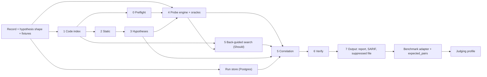

# Implementation plan

Status: plan for the target architecture in [architecture.md](architecture.md). This revision does not claim that anything is built, tested or measured. No benchmark results are recorded here. Team size: `[TODO: confirm at kickoff]`.

Time is not a constraint. Work is ordered by dependency. Milestones M1 to M3 replace hour gates. See [Milestones](#milestones).

## Existing code and the target

The repo predates this architecture. The table lists what exists in the tree and how it relates to the target. Whether each piece passes its tests today is not re-checked by this revision.

| Piece | In the tree | Relation to the target |
|---|---|---|
| `producers/sast/spring_routes.py` | Spring route-map parser with tests | Seed of stage 1. Missing: Java types on params, full call graph, sink inventory, unresolved-call flags. |
| `producers/sast/semgrep_runner.py`, `rules/` | Semgrep runner, Semgrep-format taint and pattern rules, tests | Becomes the optional Semgrep adapter (`semgrep.enabled`, off by default). It must not guess `param`. Its tests must skip when Semgrep is not installed. The rules are Semgrep syntax and do not carry over to the own sink catalogue or secrets pass `[TODO: confirm]`. |
| `pyproject.toml` | Semgrep is a regular dependency | Move to an optional extra `[proposed]`. The pipeline and its tests must pass without it. |
| `producers/benchmark.py` | Offline SAST score against VulnerableApp's expected-issues CSV | Part of the benchmark adapter. Results not recorded here. |
| `producers/dast/zap_runner.py` | ZAP-driven DAST with oracle checks and tests | Becomes the optional passive pass. The own probe engine replaces it as the verdict owner. |
| `engine/correlate/` | Tier A/B/C correlation with tests | Rework: hypothesis lineage, `link_status`, `link_origin`, ambiguity groups, the conflict rule, evidence-based confidence. |
| `engine/store/`, `engine/report/` | Postgres store, text report, SARIF export | Reusable as the base for stage 7. Needs the new fields and the suppressed file `[TODO: verify]`. |
| `cli/main.py` | `correlate` and `scan` commands | Rework the scan flow to stages 0 to 7. |
| `common/record.py` | Earlier record | Update to [finding-schema.md](finding-schema.md). Joint change. |
| `common/fixtures/` | Five fixtures in the tier-based shape | Replace with the fixtures below. Reuse where they fit `[TODO]`. |

## Must

| # | Item | Stage | Owner | Milestone `[proposed split]` |
|---|---|---|---|---|
| 1 | Preflight: baseline per route, context path, coverage report | 0 | Person B | M1 baseline and context path. M2 coverage report. |
| 2 | Route table and param bindings | 1 | Person A | M1 |
| 3 | Own sink finder and own secrets/crypto pass, plus call graph walked backward, route-granularity hypotheses | 2 to 3 | Person A. Stage 3 owner `[TODO]`. | M1 SQL sinks, call graph, hypotheses. M2 other classes, secrets and crypto pass. |
| 4 | Probe engine for four classes: differential oracles, baseline gate, canary, replay log | 4 | Person B | M1 error-based SQL injection oracle with the gate, canary and log. M2 four classes. |
| 5 | Own header and cookie-flag checks | 4 | Person B | M2 |
| 6 | Hypothesis linking with ambiguity marking, labels and scoring | 5, 7 | Person B | M1 lineage link, label, score. M2 ambiguity marking. |
| 7 | Postgres, CLI, SARIF and the suppressed file | 6, 7 | Person B | M1 Postgres and CLI report. M2 SARIF and the suppressed file. |
| 8 | Benchmark adapter and the `expected_pairs` file | 7 | Person B | M1 `expected_pairs` file. M2 adapter and measurement. |
| 9 | Judging-mode profile | all | Person B | M2 |

The four classes: SQL injection, XSS, command injection, open redirect. Path traversal is stretch `[proposed]`, though its oracle is listed in the architecture.

## Should

| Item | Stage | Owner |
|---|---|---|
| `tested_negative` logic with the adequacy rule | 6 | Person B |
| Typed seeds with AI repair | 4 | Person B |
| Session manager | 4 | Person B |
| ZAP passive pass | 4 | Person B |
| AI triage (judge `tested_negative`, demote only) | 6 | Person B |
| Best-effort preflight items | 0 | Person B |
| Back-guided static search, relaxed mode only. Producer entry `run_back_guided(target, route_map, runtime_only_findings)`. Config `backguided.enabled`, default false until measured. | 5 | Person A. Reads A's index and sink catalogue. Person B consumes the evidence through the cli seam. |
| Own flow engine (narrows `candidate_params`). Built after M2. Never blocks M1 or M2. Gate for making it the default: matches Semgrep's 35 of 45 on VulnerableApp, with Semgrep run offline as the yardstick. | 2 | Person A |

## Could

| Item | Stage | Owner |
|---|---|---|
| Semgrep optional adapter (fallback and cross-check) | 2 | Person A |
| App-log tail (`TRACE`). Never in judging mode. | 4 | Person B |
| AI payload adaptation | 4 | Person B |
| Chromium-confirmed XSS | 4 | Person B |
| Patch re-verification | 4 | Person B |
| Second-order route pairs | 4 | Person B |
| Refined `sink_id` | 2 | Person A |
| JAX-RS adapter | 1 to 2 | Person A `[proposed: in the earlier plan, absent from this tier list]` |
| Scan comparison (B-5) | 7 | Person B `[proposed: in the earlier plan, absent from this tier list]` |

## PRD bonus items

| Bonus | Where it lands |
|---|---|
| B-1 Auto-verify Code-only | Directed probes (Must item 4) |
| B-2 Cut SAST noise | `tested_negative` suppression (Should) |
| B-3 Explain links | Confidence reasons stored (Must item 6). Report display `[TODO]`. |
| B-4 Fix suggestion | AI advisory `[TODO: tier]` |
| B-5 Compare two scans | Could `[proposed]` |
| B-6 SARIF and CI exit | Must item 7 |
| B-7 Second framework | JAX-RS, Could `[proposed]` |

## Milestones

Order work by dependency. A milestone passes only when its test has been run and the output recorded in [STATE.md](STATE.md).

| Milestone | Scope |
|---|---|
| M1 spine | One command on a clean VulnerableApp run yields at least one Confirmed error-based SQL injection issue whose sink file and line match `expected_pairs`. No other stage is added until M1 passes. |
| M2 core | All four classes, own header and cookie checks, the suppressed file, the judging-mode profile, the benchmark adapter, `expected_pairs` measurement. |
| M3 extras | The Should list. The own flow engine is built after M2. |

If M1 cannot pass:

1. Cut to open redirect and error-based SQL injection.
2. Fix the spine first.

The pipeline and its tests must pass with Semgrep not installed. Semgrep stays an optional adapter, off by default.

Conflict in the tiers `[TODO: decide]`: the suppressed file is M2, but the `tested_negative` logic that fills it is Should. Proposed: M2 writes the file, and it stays empty until the logic exists.

## Split

| Person | Owns |
|---|---|
| Person A | Stage 1 (code index), stage 2 (static), the back-guided search (`run_back_guided`), the own flow engine |
| Person B | Stages 0, 4, 5, 6 and 7, the `expected_pairs` file, the judging profile |

Stage 3 (hypotheses) has no owner in the split `[TODO: decide. Proposed: Person A, since hypotheses are derived entirely from stage 1 and 2 output.]`

Person B builds against fixtures first. Both test against `common/fixtures/`. Person B consumes `run_back_guided` output through the cli seam.

### Required fixtures

Each at route granularity, with `candidate_params`. Rows 1 to 7 are required. Rows 8 to 10 cover the Should items `[proposed]`. Fixture author `[TODO: decide. Proposed: Person A, since A owns the hypothesis inputs.]`

| # | Fixture | Purpose |
|---|---|---|
| 1 | Unique directed hit | Basic lineage link |
| 2 | Ambiguous group: two same-CWE sinks on one route | `link_status: ambiguous`, alternatives, primary rule |
| 3 | `tested_negative` decoy | Suppression and the suppressed file |
| 4 | Blocked baseline | `status: blocked` |
| 5 | `no_http_path` | Code-only with a reason |
| 6 | Runtime-only header | Own header check, no correlation |
| 7 | Sweep hit, two variants: matched to a static finding by route and CWE, and no match | `link_origin: sweep`, lower confidence. Stays Runtime-only when there is no match. |
| 8 | Back-guided link, one candidate `[proposed]` | `link_origin: back_guided`, `match_mode: relaxed`, `unresolved_hops` |
| 9 | Back-guided search, several candidates `[proposed]` | `link_status: ambiguous`, `candidate_sinks`, label stays Runtime-only |
| 10 | Conflict: oracle hit on a `tested_negative` sink, two variants `[proposed]` | Reproduces: `conflict: true`, un-suppressed. Does not reproduce: `oracle_flaky: true`, no link. |

## Dependency order

Person B can build stages 4 to 7 against fixtures before stages 1 to 3 exist.

## Cut order

If scope must shrink, drop in this order. M1 and M2 items are never cut.

1. Could items, last row first
2. Own flow engine
3. Back-guided search
4. ZAP passive pass
5. AI triage and typed-seed AI repair
6. Session manager
7. Best-effort preflight items
8. `tested_negative` logic `[TODO: see the tier conflict above]`

Never cut: the contract, the code index, the own sink finder, hypothesis linking with ambiguity marking, the probe engine with its baseline gate, the run store, the CLI report, the judging profile.

## Metric targets

From the PRD. No results recorded.

| What we measure | Good | Great |
|---|---|---|
| Code detection | >60% | >85% |
| Runtime detection | >50% | >80% |
| Correct links (of 20 pairs) | >50% | >80% |
| Wrong links | <20% | <5% |
| False alarms | <30% | <10% |
| Unseen app (pairs linked) | >40% | >65% |
| Run time | <15 min | <5 min |

VulnerableApp's grader measures detection only. Semgrep is run offline as a yardstick, outside the pipeline. Link metrics are measured against the `expected_pairs` file. Ambiguity rate on VulnerableApp is measured too `[TODO]`. The back-guided search is measured by running with `backguided.enabled` on and off. If it adds no correct links, or adds any wrong link, it stays off.

## Docs rule

Only these files are kept current while coding: `AGENTS.md`, `docs/architecture.md`, `docs/finding-schema.md`, `docs/implementation-plan.md` and `docs/STATE.md`. ADRs and README polish wait until the code runs. The stale files are listed in [doc-update-tracker.md](doc-update-tracker.md).
