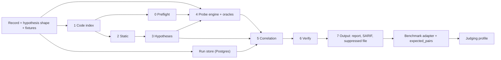

# Implementation plan

Status: plan for the target architecture in [architecture.md](architecture.md). This revision does not claim that anything is built, tested or measured. No benchmark results are recorded here. Hackathon length and team size: `[TODO: confirm at kickoff]`.

The Must tier is planned for 4 to 5 hours.

## Existing code and the target

The repo predates this architecture. The table lists what exists in the tree and how it relates to the target. Whether each piece passes its tests today is not re-checked by this revision.

| Piece | In the tree | Relation to the target |
|---|---|---|
| `producers/sast/spring_routes.py` | Spring route-map parser with tests | Seed of stage 1. Missing: Java types on params, full call graph, sink inventory, unresolved-call flags. |
| `producers/sast/semgrep_runner.py`, `rules/` | Semgrep runner, Semgrep-format taint and pattern rules, tests | Becomes the optional Semgrep adapter (`semgrep.enabled`, off by default). It must not guess `param`. Its tests must skip when Semgrep is not installed. The rules are Semgrep syntax and do not carry over to the own sink catalogue or secrets pass `[TODO: confirm]`. |
| `pyproject.toml` | Semgrep is a regular dependency | Move to an optional extra `[proposed]`. The pipeline and its tests must pass without it. |
| `producers/benchmark.py` | Offline SAST score against VulnerableApp's expected-issues CSV | Part of the benchmark adapter. Results not recorded here. |
| `producers/dast/zap_runner.py` | ZAP-driven DAST with oracle checks and tests | Becomes the optional passive pass. The own probe engine replaces it as the verdict owner. |
| `engine/correlate/` | Tier A/B/C correlation with tests | Rework: hypothesis lineage, `link_status`, ambiguity groups, evidence-based confidence. |
| `engine/store/`, `engine/report/` | Postgres store, text report, SARIF export | Reusable as the base for stage 7. Needs the new fields and the suppressed file `[TODO: verify]`. |
| `cli/main.py` | `correlate` and `scan` commands | Rework the scan flow to stages 0 to 7. |
| `common/record.py` | Earlier record | Update to [finding-schema.md](finding-schema.md). Joint change. |
| `common/fixtures/` | Five fixtures in the tier-based shape | Replace with the seven fixtures below. Reuse where they fit `[TODO]`. |

## Must

| # | Item | Stage | Owner |
|---|---|---|---|
| 1 | Preflight: baseline per route, context path, coverage report | 0 | Person B |
| 2 | Route table and param bindings | 1 | Person A |
| 3 | Own sink finder and own secrets/crypto pass, plus call graph walked backward, route-granularity hypotheses | 2 to 3 | Person A. Stage 3 owner `[TODO]`. |
| 4 | Probe engine for four classes: differential oracles, baseline gate, canary, replay log | 4 | Person B |
| 5 | Own header and cookie-flag checks | 4 | Person B |
| 6 | Hypothesis linking with ambiguity marking, labels and scoring | 5, 7 | Person B |
| 7 | Postgres, CLI, SARIF and the suppressed file | 6, 7 | Person B |
| 8 | Benchmark adapter and the `expected_pairs` file | 7 | Person B |
| 9 | Judging-mode profile | all | Person B |

The four classes: SQL injection, XSS, command injection, open redirect. Path traversal is stretch `[proposed]`, though its oracle is listed in the architecture.

## Should

| Item | Stage | Owner |
|---|---|---|
| `tested_negative` logic with the adequacy rule | 6 | Person B |
| Typed seeds with AI repair | 4 | Person B |
| Session manager | 4 | Person B |
| ZAP passive pass | 4 | Person B |
| AI triage (judge `tested_negative`, demote only) | 6 | Person B |
| Best-effort preflight items | 0 | Person B |
| Back-guided static search for sweep hits | 5 | Person B `[proposed]`. Reads the stage 1 index through the contract. |

## Could

| Item | Stage | Owner |
|---|---|---|
| Own flow engine (narrows `candidate_params`). Promotion gate: matches Semgrep's 35 of 45 on VulnerableApp, Semgrep run offline as the yardstick. | 2 | Person A |
| Semgrep optional adapter (fallback and cross-check) | 2 | Person A |
| App-log tail (`TRACE`). Never in judging mode. | 4 | Person B |
| AI payload adaptation | 4 | Person B |
| Chromium-confirmed XSS | 4 | Person B |
| Patch re-verification | 4 | Person B |
| Second-order route pairs | 4 | Person B |
| Refined `sink_id` | 2 | Person A |
| JAX-RS adapter | 1 to 2 | Person A `[proposed: in the earlier plan, absent from this tier list]` |
| Scan comparison (B-5) | 7 | Person B `[proposed: in the earlier plan, absent from this tier list]` |

## PRD bonus items

| Bonus | Where it lands |
|---|---|
| B-1 Auto-verify Code-only | Directed probes (Must item 4) |
| B-2 Cut SAST noise | `tested_negative` suppression (Should) |
| B-3 Explain links | Confidence reasons stored (Must item 6). Report display `[TODO]`. |
| B-4 Fix suggestion | AI advisory `[TODO: tier]` |
| B-5 Compare two scans | Could `[proposed]` |
| B-6 SARIF and CI exit | Must item 7 |
| B-7 Second framework | JAX-RS, Could `[proposed]` |

## Gate at hour 2

Question: is the spine working end to end?

Pass test: from one command on a clean run, VulnerableApp yields at least one Confirmed SQL injection issue with the correct sink file and line, matching `expected_pairs`.

If the gate fails:

1. Stop adding stages.
2. Cut to the two simplest oracle classes: open redirect and error-based SQL injection.
3. Fix the spine first.

This replaces the earlier hour-5 flow-engine gate.

## Split

| Person | Owns |
|---|---|
| Person A | Stage 1 (code index) and stage 2 (static) |
| Person B | Stages 0, 4, 5, 6 and 7, the `expected_pairs` file, the judging profile |

Stage 3 (hypotheses) has no owner in the split `[TODO: decide. Proposed: Person A, since hypotheses are derived entirely from stage 1 and 2 output.]`

Person B builds against fixtures first. Both test against `common/fixtures/`.

### Required fixtures

Each at route granularity, with `candidate_params`. Fixture author `[TODO: decide. Proposed: Person A, since A owns the hypothesis inputs.]`

| # | Fixture | Purpose |
|---|---|---|
| 1 | Unique directed hit | Basic lineage link |
| 2 | Ambiguous group: two same-CWE sinks on one route | `link_status: ambiguous`, alternatives, primary rule |
| 3 | `tested_negative` decoy | Suppression and the suppressed file |
| 4 | Blocked baseline | `status: blocked` |
| 5 | `no_http_path` | Code-only with a reason |
| 6 | Runtime-only header | Own header check, no correlation |
| 7 | Sweep hit, two variants `[proposed]`: a sink found by the back-guided search, and none found | `link_origin: sweep_derived`, lower confidence. Stays Runtime-only when none is found. |

## Dependency order

Person B can build stages 4 to 7 against fixtures before stages 1 to 3 exist.

## Cut list

If short on time, drop in this order after the gate rule above:

1. Could items, last row first
2. ZAP passive pass
3. AI triage and typed-seed AI repair
4. Session manager
5. Best-effort preflight items
6. `tested_negative` logic

Never cut: the contract, the code index, the own sink finder, hypothesis linking with ambiguity marking, the probe engine with its baseline gate, the run store, the CLI report, the judging profile.

## Metric targets

From the PRD. No results recorded.

| What we measure | Good | Great |
|---|---|---|
| Code detection | >60% | >85% |
| Runtime detection | >50% | >80% |
| Correct links (of 20 pairs) | >50% | >80% |
| Wrong links | <20% | <5% |
| False alarms | <30% | <10% |
| Unseen app (pairs linked) | >40% | >65% |
| Run time | <15 min | <5 min |

VulnerableApp's grader measures detection only. Semgrep is run offline as a yardstick, outside the pipeline. Link metrics are measured against the `expected_pairs` file. Ambiguity rate on VulnerableApp is measured too `[TODO]`.

## Docs rule

Only these four files are kept current while coding: `AGENTS.md`, `docs/architecture.md`, `docs/finding-schema.md`, `docs/implementation-plan.md`. ADRs and README polish wait until the code runs. The stale files are listed in [doc-update-tracker.md](doc-update-tracker.md).
