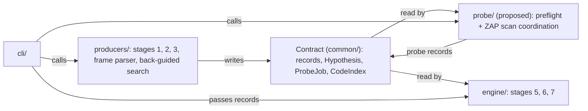

# Repo structure

The authoritative map of what lives where. Work is split by build stage, not by person: see [implementation-plan.md](implementation-plan.md#build-stages). Working rules: [CONTRIBUTING.md](../CONTRIBUTING.md). Pipeline stages: [architecture.md](architecture.md).

## Tree

```
.
├── AGENTS.md
├── CONTRIBUTING.md
├── README.md
├── .gitignore
├── common/              contract: changes are flagged as contract changes
│   └── fixtures/
├── producers/
│   ├── sast/            stages 1 and 2: code index, sink finder, secrets/crypto pass,
│   │                    route table, frame parser, back-guided search, flow engine,
│   │                    Semgrep adapter (optional)
│   ├── hypotheses/      stage 3 [proposed, not created]
│   └── dast/            ZAP API client and active-scan integration
├── probe/               [proposed, not created]: stage 0 preflight and stage 4 ZAP scan coordinator
├── engine/
│   ├── correlate/       stages 5 and 6: correlation, verify, labels, scoring
│   ├── store/           Postgres persistence
│   └── report/          report, SARIF export, suppressed file, coverage report
├── cli/                 the single integration seam
├── infra/               our stack's Docker definitions, ZAP, the practice target
├── scripts/             one-off checks, not pipeline code
├── docs/
└── tests/
    ├── producers/
    ├── probe/           [proposed]
    ├── engine/
    └── cli/
```

## What each directory holds

| Directory | Holds | First build stage |
|---|---|---|
| `common/` | Finding record, `Hypothesis`, `ProbeJob`, `ScanTarget`, `CodeIndex`, SARIF mapping, CWE/type ↔ grader vocabulary map, contract logic | `BS1` |
| `common/fixtures/` | Hand-made sample records and the `expected_pairs` file `[proposed path: common/fixtures/expected_pairs/vulnerableapp.yaml]` | `BS1`, `BS2` |
| `producers/sast/` | Stages 1 and 2: `spring_routes.py`, `call_graph.py`, `code_index.py`, `sink_finder.py`, `static_stage.py`, `catalogue/`. Frame parser, back-guided search, flow engine, optional Semgrep adapter | `BS2`, `BS3` |
| `producers/hypotheses/` `[proposed, not created]` | Stage 3: directed and sweep hypotheses | `BS3` |
| `producers/dast/` | ZAP API client and active-scan integration; ZAP generates and sends payload requests | `BS4` |
| `probe/` `[proposed, not created]` | Stage 0 preflight and stage 4 ZAP scan coordinator: scheduler, job records, baseline gates, request attribution, verification replay, differential oracles, probe header and canaries, state guard, replay log, header and cookie checks | `BS4` |
| `engine/correlate/` | Stage 5 correlation, stage 6 verify, labels, scoring | `BS5`, `BS7` |
| `engine/store/` | Postgres persistence | `BS5` |
| `engine/report/` | Report, SARIF export, suppressed file, coverage report | `BS5`, `BS7`, `BS8` |
| `cli/` | Calls the stages in order | `BS5` |
| `infra/` | `compose.yaml` for Postgres and the CLI, `zap.compose.yaml` for ZAP, `vulnerableapp.compose.yaml` for the practice target. Images are pinned by digest. | `BS0` |
| `scripts/` | One-off checks such as `bs0_zap_check.py`. Pipeline code never imports them. | `BS0` |
| `.targets/` | Local checkouts of target apps. Ignored by git and Docker. | `BS0` |
| `docs/` | See [Docs](#docs) | |
| `tests/<component>/` | Tests against `common/fixtures/` | With each component |

## Module boundary

The cut follows the finding record and the pipeline stages. It keeps framework-specific code behind the adapter.

- **The static side** is stages 1, 2 and 3, the frame parser, the back-guided search and the flow engine. All Java and framework parsing lives here. It never sends HTTP.
- **The dynamic side and the consumers** are stages 0, 4, 5, 6 and 7. All HTTP lives here, and they read all records. They never parse Java.
- They meet only through the contract in `common/` and the CLI seam. No static module imports probe or engine code, and no probe or engine module imports static code.
- **Named exception: contract logic.** `common/` may hold code both sides must compute identically: the record model, `Hypothesis`, `ProbeJob`, `ScanTarget`, `CodeIndex`, `normalise_route(url, route_map)` and the dedupe key function. Changes are flagged as contract changes. See [decisions.md](decisions.md) D-15.



## ZAP active-scan integration

- Create `probe/` in `BS4` for the stage 0 and stage 4 coordinator.
- Keep the ZAP API client in `producers/dast/` unless moving it is chosen deliberately. ZAP is the active probe engine, not a passive-only optional adapter.

## Fixtures first

1. Freeze the contract in `common/` in `BS1`, after `BS0` has settled job size.
2. Write the fixtures listed in [implementation-plan.md](implementation-plan.md#required-fixtures) in the build stage each one names.
3. Check each fixture against the correlation cases before the freeze.
4. Consumers can be tested against fixtures before the live stages that feed them exist.
5. Fixtures sit in `common/`, so changing them is a contract change.

## The cli/ integration seam

- The CLI builds `ScanTarget` and calls the stages in order: index, static, hypotheses, preflight, probe, then `run_back_guided` with the runtime-only findings `[proposed order]`, then correlate, verify and output.
- The CLI passes the adapter's frame parser to correlation, so correlation does not import static code.
- Entry signatures: `[TODO: ratify in BS1]`. Stage data shapes: [finding-schema.md](finding-schema.md#stage-data).
- This is the only place the two sides connect.
- If an entry needs to change shape, that is a contract change in `common/`.

## Docs

| File | Rule |
|---|---|
| `architecture.md`, `finding-schema.md`, `implementation-plan.md`, root `AGENTS.md` | Kept current while coding |
| `STATE.md` | Overwritten at each save |
| `decisions.md` | Stale until the code runs |
| `prd.md` | Organisers' spec. Read-only. |
| Root `README.md` | Updated when commands change |
