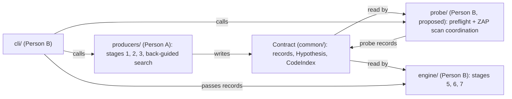

# Repo structure and ownership

The authoritative ownership map. Check here when unsure who owns what. Rules for working within it: [CONTRIBUTING.md](../CONTRIBUTING.md). Pipeline stages: [architecture.md](architecture.md). Split and milestones: [implementation-plan.md](implementation-plan.md).

Person A and Person B are role labels. Who is who: `[TODO: confirm at kickoff]`

## Tree

```
.
├── AGENTS.md            whoever is free, own PR
├── CONTRIBUTING.md      [TODO: owner]
├── README.md            whoever is free, own PR
├── .gitignore           [TODO: owner]
├── common/              JOINT, by agreement only
│   └── fixtures/        Person A writes, Person B reviews
├── producers/           PERSON A
│   ├── sast/            stages 1 and 2: code index, sink finder, secrets/crypto pass,
│   │                    route table, back-guided search, flow engine, Semgrep adapter (optional)
│   ├── hypotheses/      stage 3 [proposed, not created]
│   └── dast/            current ZAP runner. Person B owns its active-scan integration
├── probe/               PERSON B [proposed, not created]: stage 0 preflight and ZAP scan coordinator
├── engine/              PERSON B
│   ├── correlate/       stages 5 and 6: correlation, verify, labels, scoring
│   ├── store/           Postgres persistence
│   └── report/          report, SARIF export, suppressed file
├── cli/                 PERSON B, the single integration seam
├── infra/               JOINT, rare edits
├── docs/                split by file
└── tests/
    ├── producers/       PERSON A
    ├── probe/           PERSON B [proposed]
    ├── engine/          PERSON B
    └── cli/             PERSON B
```

Stage 3 (hypotheses) is Person A's. Its code lives in `producers/hypotheses/` `[proposed, not created]`, next to the index and the sink catalogue.

## Owner per directory

| Directory | Owner | Holds |
|---|---|---|
| `common/` | Joint | Finding record, `Hypothesis`, `ScanTarget`, `CodeIndex`, SARIF mapping, CWE/type ↔ grader vocabulary map, contract logic |
| `common/fixtures/` | Person A writes. Person B reviews each fixture before the contract freeze. | Hand-made sample records and the `expected_pairs` file `[proposed path: common/fixtures/expected_pairs/vulnerableapp.yaml]` |
| `producers/sast/` | Person A | Stages 1 and 2, back-guided search, flow engine, optional Semgrep adapter |
| `producers/hypotheses/` `[proposed, not created]` | Person A | Stage 3: directed and sweep hypotheses |
| `producers/dast/` | Person B | ZAP API client and active-scan integration; ZAP generates and sends payload requests. Project-owned deterministic oracles validate captured responses. |
| `probe/` `[proposed, not created]` | Person B | Stage 0 preflight and stage 4 ZAP scan coordinator: hypothesis/job mapping, baseline gates, differential oracles, canary/header propagation, replay log, header and cookie checks |
| `engine/correlate/` | Person B | Stage 5 correlation, stage 6 verify, labels, scoring |
| `engine/store/` | Person B | Postgres persistence |
| `engine/report/` | Person B | Report, SARIF export, suppressed file |
| `cli/` | Person B | Calls the stages in order |
| `infra/` | Joint | Our stack's Docker definitions |
| `docs/` | Per file | See [Doc ownership](#doc-ownership) |
| `tests/<component>/` | Component owner | Tests against `common/fixtures/` |

### ZAP active-scan integration

The HTTP probe code is Person B's, not Person A's. An earlier version of this map gave all HTTP attack logic to Person A.

- Stages 0 and 4 are Person B's.
- Until `probe/` exists, `producers/dast/` is Person B's.
- When code starts, create `probe/` for the stage 0 and stage 4 coordinator. Keep the ZAP API integration in `producers/dast/` unless the team jointly chooses to move it. ZAP is the active probe engine, not a passive-only optional adapter.

## Doc ownership

Split by file. Never two people in one file.

| File | Owner |
|---|---|
| `architecture.md` | Person A |
| `finding-schema.md` | Person A drafts, Person B reviews |
| `implementation-plan.md` | Person B |
| `decisions.md` | Person B |
| `repo-structure.md` | `[TODO: confirm owner]` |
| `STATE.md` | Whoever saves state. Overwritten each time. |
| `prd.md` | Organisers' spec. Read-only. |
| Root `README.md`, `AGENTS.md` | Whoever is free, in their own small PR, never alongside code |

## The record-contract boundary

The cut follows the finding record and the stage boundary.

- **Person A builds the static side.** Stages 1, 2 and 3, the back-guided search and the flow engine. A owns all Java and framework parsing. A never sends HTTP.
- **Person B builds the dynamic side and the consumers.** Stages 0, 4, 5, 6 and 7. B sends all HTTP and reads all records. B never parses Java.
- They meet only through the contract in `common/`. Never through shared component code. No static module imports probe or engine code, and no probe or engine module imports static code.
- **Named exception: contract logic.** `common/` may hold code both halves must compute identically: the record model, `Hypothesis`, `ScanTarget`, `CodeIndex`, `normalise_route(url, route_map)` and the dedupe key function. Both sides import it. Changes are stop-the-world, like the schema. See [decisions.md](decisions.md) D-15.



## Fixtures first

1. Freeze the contract in `common/` before anyone codes against it.
2. Person A writes the fixtures listed in [implementation-plan.md](implementation-plan.md#required-fixtures): seven required, three more for the Should items `[proposed]`.
3. Person B reviews each fixture against the correlation cases before the freeze.
4. Person B builds and tests stages 4 to 7 against the fixtures before Person A's stages exist.
5. Fixtures sit in `common/`, so changing them is a joint call.

## The cli/ integration seam

- The CLI builds `ScanTarget` and calls the stages in order: index, static, hypotheses, preflight, probe, then `run_back_guided` (Person A's entry) with the runtime-only findings `[proposed order]`, then correlate, verify and output.
- Entry signatures: `[TODO: ratify]`. Stage data shapes: [finding-schema.md](finding-schema.md#stage-data).
- This is the only place the two halves connect. It sits on Person B's side, so there is no shared orchestration file.
- If Person A needs an entry to change shape, that is a contract change in `common/`, agreed jointly.
